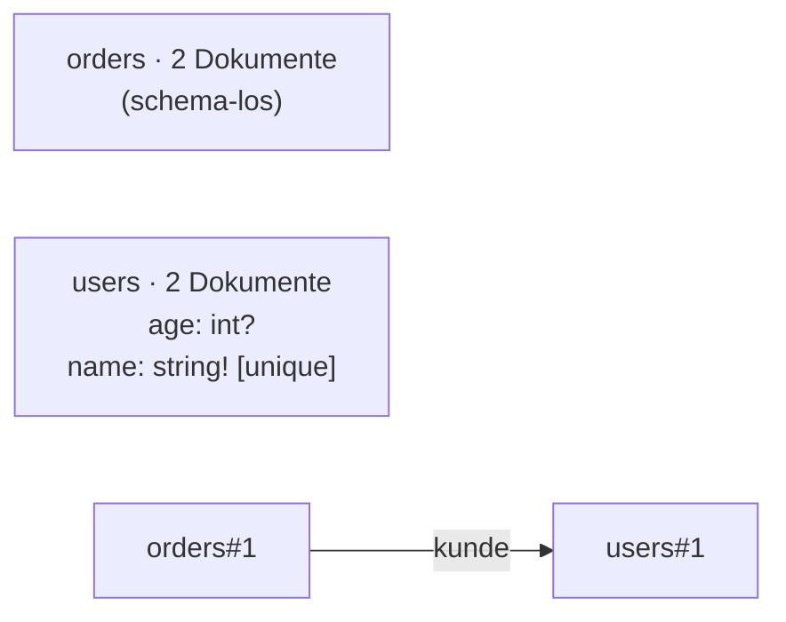

# Datenbank-Graph visualisieren (FA-22) – v0.15

| Feld | Wert |
|---|---|
| Status | umgesetzt (v0.15) |
| Bezug | Anforderungen FA-22 (Kann), FA-14 (Snapshot), FA-18 (Referenzen), FA-20 (Schema), FA-10 (Indizes) |
| Abhängigkeiten | **keine** (nur C++17 + eigener JSON-Writer/Parser) |

Ziel: Eine bestehende Database – Collections inkl. optionalem Schema/Indizes und deren
FA-18-Referenzen – als **textbasierten Graph** ausgeben, den ein LLM leicht versteht
und der direkt gerendert werden kann.

## API

```cpp
#include <memdb/memdb.hpp>

memdb::DbGraph g = memdb::DbGraph::fromDatabase(db);              // laufende DB
memdb::DbGraph g2 = memdb::DbGraph::fromSnapshotFile("shop.inmemdb.json"); // aus FA-14-Snapshot

std::string mermaid = g.toMermaid();   // "graph LR ..." – rendert direkt (GitHub/VS Code/LLM)
std::string json    = g.toJson();      // strukturiert für LLM/Tooling
std::string md      = g.toMarkdown();  // Doku-Tabellen
std::string sum     = g.summary();     // "2 Collections, 4 Dokumente, 1 Referenzen"
```

- `GraphNode`: Collection-Name, Dokumentanzahl, `hasSchema`, Felder (`GraphField`: Name/Pfad,
  Typname aus `docs/type-mapping.md`, `nullable`, Index-Annotation `""`/`"index"`/`"unique"`).
- `GraphEdge`: `from`/`to` als `collection#id` (Dokument) oder `collection` (Collection-Level),
  `relation`, `dangling` (Ziel existiert nicht mehr).
- Die interne Speicher-Collection der Referenzen (`__references`) erscheint **nicht** als
  Knoten, nur als Kanten. Bei `fromSnapshotFile` sind Dokument-IDs nicht im Snapshot
  enthalten – `dangling` wird dann nur über die Ziel-Collection geprüft.

## Formate

**Mermaid** (Default, rendert sofort):



Konventionen: `?` = nullable, `!` = notNull, `[unique]`/`[index]` = Index; Kantenlabel =
Relation (+ ` (dangling)`); Knoten-IDs sind sanitizierte Namen (`orders#1` → `orders_1`).

**JSON** (maschinenlesbar):

```json
{"collections":[{"name":"users","documents":2,"schema":{"fields":[{"name":"name","type":"string","nullable":false,"index":"unique"}]}},{"name":"orders","documents":2,"schema":null}],"references":[{"from":"orders#1","to":"users#1","relation":"kunde","dangling":false}]}
```

**Markdown**: Tabelle Collections (Name, #Dokumente, Schema ja/nein, Felder) + Tabelle
Referenzen (Von, Nach, Relation, Dangling).

## CLI

```sh
./build/inmemdb_graph shop.inmemdb.json                 # Mermaid auf stdout (+ Summary als Kommentar)
./build/inmemdb_graph shop.inmemdb.json --format json
./build/inmemdb_graph shop.inmemdb.json --format all --out graph   # graph.mmd, graph.json, graph.md
```

Damit genügt für ein LLM **eine Snapshot-Datei** als Input.

## Implementierung

`include/memdb/db_graph.hpp` + `src/db_graph.cpp` (kein Core-Eingriff; liest nur öffentliche
API bzw. den Snapshot-Parser `src/json.*`). CLI: `tools/db_graph.cpp` (`inmemdb_graph`).
Beispiel: `examples/15_db_graph.cpp`; Tests: `tests/test_db_graph.cpp`.
