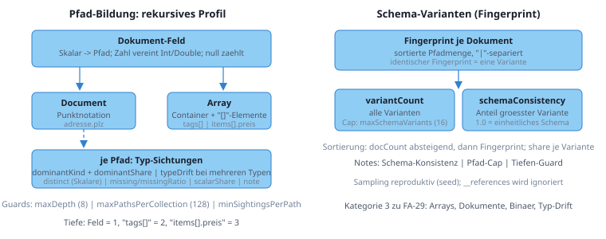

# Komplexe Metadaten-Analyse (FA-34) – API-Referenz

| Feld | Wert |
|---|---|
| Status | umgesetzt – **ohne externe Abhängigkeiten** (nur InMemDB + C++17) |
| Bezug | Anforderungen FA-34 (Kann); Kategorie-3-Pipeline zur Datencharakter-Kategorisierung (FA-29) |
| Modul | `include/memdb/complex_analysis.hpp` + `src/complex_analysis.cpp` |

Das Modul analysiert **komplexe Datenstrukturen** – verschachtelte Dokumente,
Arrays (auch Arrays aus Dokumenten), Binärwerte und Typ-Drift – und leitet daraus
Metadaten ab, die im Dokument selbst nicht stehen: ein rekursives Pfad-Profil in
Punktnotation (`"adresse.plz"`, `"tags[]"`, `"items[].preis"`), je Pfad gesichtete
Wert-Typen mit dominantem Typ und Typ-Drift, Skalar-Distinct-Werte und
Fehlstellen sowie Schema-Varianten (Fingerprint-Gruppen) mit
Schema-Konsistenz. Es ist die Analyse-Pipeline für Collections der Kategorie
`DataCategory::Complex` (FA-29).

## Funktionen

```cpp
#include <memdb/memdb.hpp>
#include <memdb/complex_analysis.hpp>

memdb::ComplexAnalysisOptions opts;
//   sampleSize/seed          – reproduktives Sampling (0 = alle Dokumente)
//   maxPathsPerCollection (128) – Cap: neue Pfade jenseits des Caps werden ignoriert
//   maxDepth (8)             – Verschachtelungs-Guard für die Pfad-Rekursion
//   maxSchemaVariants (16)   – gemeldete Varianten; weitere werden nur gezählt
//   maxDistinctPerPath (4096) – Speicher-Guard für distinct-Werte je Pfad
//   minSightingsPerPath (1)  – Pfade mit weniger Sichtungen werden übersprungen

// Nur die Pfad-Analysen einer Collection
auto paths = memdb::analyzeComplexFields(coll, opts);

// Komplett: Pfad-Profil + Schema-Varianten
memdb::ComplexCollectionAnalysis res = memdb::analyzeComplex(coll, opts);
//   res.paths[i]              – {path, depth, kinds, dominantKind, distinct, ...}
//   res.variants[i]          – {fingerprint, fields, docCount, share}
//   res.schemaConsistency     – Anteil der größten Variante
//   res.notes                 – Auffälligkeiten (z. B. Typ-Drift, Caps)
// Mehrere Collections (auch database-übergreifend; __references wird ignoriert)
auto all = memdb::analyzeComplex(db, opts);

// Reports
std::string j  = memdb::toJson(paths[0]); // eine Pfad-Analyse
std::string j2 = memdb::toJson(res);     // ganze Collection
std::string md = memdb::toMarkdown(res); // Tabellen inkl. Schema-Varianten
```

## Was wird pro Pfad analysiert (`ComplexPathAnalysis`)?

| Merkmal | Bedeutung |
|---|---|
| `path`, `depth`, `isElementPath` | Pfad in Punktnotation; `depth` 1 = Top-Level-Feld, `"tags[]"` hat Tiefe 2, `"items[].preis"` Tiefe 3; `isElementPath` kennzeichnet `"[]"`-Elementpfade |
| `kinds` | Sichtungen je Wert-Typ (`null`, `boolean`, `number`, `text`, `binary`, `document`, `array`), nach Typ sortiert |
| `dominantKind`, `dominantShare` | häufigster Typ; Anteil an den Sichtungen (Tie-Break: niedrigster Typ) |
| `count`, `distinct`, `missing`, `missingRatio` | Sichtungen gesamt; distinct skalare Werte (gedeckelt durch `maxDistinctPerPath`); untersuchte Dokumente ohne diesen Pfad |
| `scalarShare` | Anteil skalarer Sichtungen (null/boolean/number/text/binary) |
| `typeDrift` | `true`, wenn mehr als ein Typ am Pfad gesichtet wurde |
| `note` | Interpretations-Hinweise auf Deutsch (z. B. `"Typ-Drift: number (60 %), boolean (20 %), text (20 %)"`, `"Array aus Dokumenten (3 Elemente)"`, `"Binärdaten (2 Werte)"`) |

## Schema-Varianten (`ComplexSchemaVariant`)

Jedes untersuchte Dokument erhält einen Fingerprint aus der sortierten Menge
seiner Pfade (`"|"`-separiert); Dokumente mit identischem Fingerprint bilden eine
Variante. `schemaConsistency` ist der Anteil der größten Variante an den
untersuchten Dokumenten (1.0 = einheitliches Schema). Varianten werden nach
Dokumentzahl absteigend gemeldet und über `maxSchemaVariants` gedeckelt;
`variantCount` zählt alle.



Zwei zentrale Elemente im Bild: links die rekursive Pfad-Bildung – Skalarwerte
am Feldpfad, Arrays erzeugen den Container-Pfad plus `"[]"`-Elementpfad,
Dokumente werden per Punktnotation aufgelöst, je Pfad mit Tiefen- und
Pfad-Cap; rechts die Schema-Varianten – Fingerprint aus sortierten Pfaden,
Gruppierung, Konsistenz-Anteil und Cap.

## Details

- Read-only; ein Scan pro Collection. `__references` wird ignoriert; die Analyse
  betrachtet jede Collection isoliert.
- Zahlen vereinen Int und Double zu `number`; `null` am Pfad zählt als Sichtung
  (das Feld existiert), fehlende Felder zählen in `missing`.
- Guards: nach `maxPathsPerCollection` Pfaden werden neue Pfade ignoriert (Note
  `"Pfad-Cap erreicht"`); die Rekursion stoppt bei `maxDepth` (Note
  `"Tiefen-Guard aktiv"`); `distinct` ist je Pfad auf `maxDistinctPerPath`
  gedeckelt; Pfade unter `minSightingsPerPath` Sichtungen werden übersprungen.
- Sampling (`sampleSize > 0`) ist reproduktiv (fester `seed`); `missingRatio`,
  `share` und `schemaConsistency` beziehen sich stets auf die gesampelte
  Dokumentmenge.
- Reports enthalten ausschließlich Zähler und Quotienten – per Konstruktion kein
  `inf`/`nan` im JSON.
- Tests: `tests/test_complex_analysis.cpp` (175 Checks): u. a. verschachtelte
  Dokumente, Arrays und Arrays aus Dokumenten, Typ-Drift, Schema-Varianten,
  Binär und null, Sampling, alle Guards, Reports und leere Collections.

Siehe auch: [character.md](character.md) für die Vorab-Kategorisierung,
[numeric-analysis.md](numeric-analysis.md) für die Kategorie-1-Pipeline und
[mixed-analysis.md](mixed-analysis.md) für die Kategorie-2-Pipeline.
