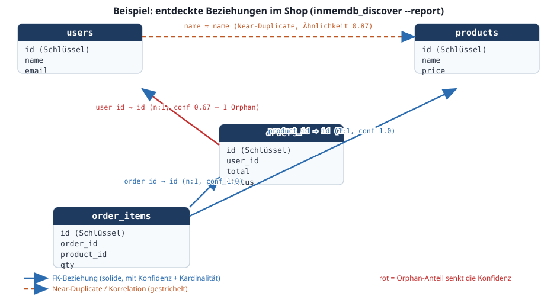
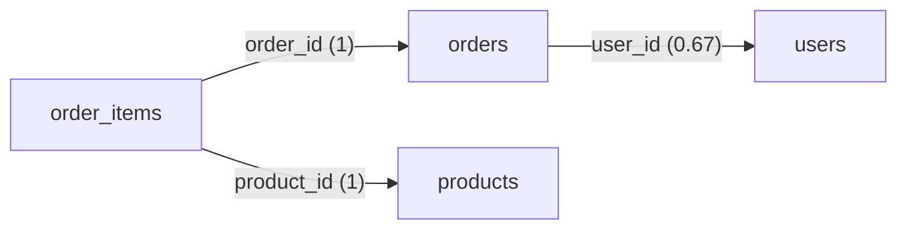
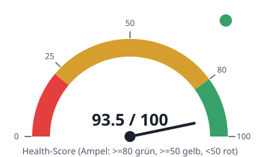

# Discovery-Guide: Beziehungen & Abhängigkeiten automatisch finden (FA-27, v0.29–v0.40)

| Feld | Wert |
|---|---|
| Modul | `include/memdb/discovery.hpp` + `src/discovery.cpp` |
| Abhängigkeiten | **keine** – nur InMemDB selbst + C++17 (NFA-06) |
| Wirkt auf | read-only; verändert keine Daten (außer `applyDiscovered`, das gezielt Referenzen anlegt) |
| Umfang | collection- **und database-übergreifend** |
| API-Referenz | [docs/de/guides/discovery.md](discovery.md) · Tests: `tests/test_discovery*.cpp` (124 Checks) |

Dieser Guide erklärt **jede Methode des Discovery-Moduls verständlich mit Beispielen**.
Die API-Referenz mit allen Signaturen findest du in [docs/de/guides/discovery.md](discovery.md).

---

## 1. Was macht das Discovery-Modul?

InMemDB ist schema-los: Beziehungen zwischen Collections existieren nicht automatisch,
sie müssen erst **erkannt** werden. Das Discovery-Modul untersucht die vorhandenen
**Werte** und findet heraus:

- **Fremdschlüssel** (welches Feld verweist auf welches andere Feld?)
- **Funktionale Abhängigkeiten** innerhalb einer Collection (welches Feld bestimmt welches andere?)
- **Korrelationen** zwischen Feldern (steigen zwei Zahlen together? hängt ein Status von einem anderen Feld ab?)
- **Near-Duplicates** (fast gleiche Texte, z. B. Tippfehler – auch über Collections hinweg)
- **Ausreißer** in numerischen Feldern (z-Score + IQR/Tukey-Fence, v0.40) – und als Faktor im Health-Score
- **Orphans** (Verweise, die ins Leere zeigen – Integritätsprüfung)
- **Candidate Keys** (welche Feldkombination identifiziert ein Dokument eindeutig?)
- **Diffs & Merge-Vorschläge** (wie ähnlich sind zwei Collections/Databases?)
- und fasst alledem in einem **Analyse-Report mit Health-Score** zusammen (`analyze()`, v0.33, inkl. Ausreißer ab v0.40)

Alles arbeitet auf einer internen Momentaufnahme („Scan“) pro Collection: Feldnamen plus
pro Feld die Menge der distinct Werte und die Anzahl der Dokumente mit dem Feld. Bei
großen Collections kann man reproduktiv sampeln (`DiscoveryOptions::sampleSize` +
`seed`, nutzt `Collection::sample`, v0.27).

**Wichtig:** Discovery arbeitet rein auf Werten. Es „versteht“ keine Semantik – ein
Befund mit hoher Konfidenz ist ein starker Hinweis, kein Beweis. Deshalb gibt es zu
jedem Befund `support`, `confidence`, `sampleSize` und `note`.

---

## 2. Schnellstart

### Im Code

```cpp
#include <memdb/memdb.hpp>
#include <memdb/discovery.hpp>

memdb::Database db("shop");
db.loadFromFile("shop.inmemdb.json");

// alles auf einmal: Gesamtanalyse mit Health-Score + Report (v0.33)
memdb::AnalysisReport rep = memdb::analyze(db);
memdb::printSummary(rep, std::cout);              // Konsole
std::ofstream("analyse.md")   << memdb::toMarkdown(rep);   // Markdown-Report
std::ofstream("analyse.json") << memdb::toJson(rep);       // JSON
std::ofstream("graph.mmd")    << memdb::toMermaid(rep);    // Mermaid-Graph

// oder einzeln, z. B. nur Fremdschlüssel (auch über mehrere Databases hinweg):
auto rels = memdb::discoverForeignKeys({db.collection("orders"), db.collection("users")});
```

### Per CLI (Snapshot-Dateien, auch mehrere = cross-database)

```sh
inmemdb_discover shop.inmemdb.json                          # Relationen als JSON
inmemdb_discover shop.inmemdb.json --report analyse         # + analyse.report.md / .relations.json / .graph.mmd
inmemdb_discover a.json b.json --min-confidence 0.9         # strengere FK-Filter
inmemdb_discover shop.enc --password geheim --mermaid       # verschlüsselte Datei
```

---

## 3. Das durchgehende Beispiel

Ein kleiner Shop als Snapshot `shop.inmemdb.json` (erzeugt z. B. per CSV-Import oder im Code):

| Collection | Felder | Inhalt |
|---|---|---|
| `users` | `id`, `name`, `email` | 3 Kunden (id 1–3) |
| `products` | `id`, `name`, `price` | 3 Produkte (id 100–102, u. a. „Ada Lovelace Poster“) |
| `orders` | `id`, `user_id`, `total`, `status` | 3 Bestellungen – eine mit `user_id = 999` (**Orphan!**) |
| `order_items` | `id`, `order_id`, `product_id`, `qty` | 3 Positionen |



So sieht der Beziehungsgraph aus, den `inmemdb_discover --report` als Mermaid ausgibt
(auszugsweise, reale Ausgabe):



---

## 4. Die Methoden im Einzelnen

### 4.1 `discoverForeignKeys(colls, opts)` – Fremdschlüssel per Werte-Überlappung (v0.29)

**Was:** Vergleicht jedes Feld jeder Collection mit jedem Feld jeder anderen Collection
(auch aus verschiedenen `Database`-Objekten) und meldet `A.feld → B.zielfeld`, wenn die
Werte von `A.feld` überwiegend in den Werten von `B.zielfeld` vorkommen.

**Wie:** Pro Feldpaar wird die Schnittmenge der distinct Werte gebildet. Ein Befund
braucht **mindestens 2 gemeinsame Werte** (ein Einzeltreffer ist Zufall).

- `confidence` = Anteil der Werte von `A.feld`, die in `B.zielfeld` vorkommen
  (1.0 = alle; ein Orphan senkt die Konfidenz, z. B. 2 von 3 → 0.67)
- `support` = Anteil der Dokumente von `A`, die das Feld überhaupt tragen
- `cardinality` (v0.30, aus A-Sicht): `1:1` / `n:1` / `1:n` / `n:m` – abgeleitet aus
  der Eindeutigkeit beider Seiten (distinct == Anzahl Dokumente mit Feld)
- Namensheuristik: Befunde mit `*_id`/`*_ref` als Quellfeld oder `id`/`pk` als Zielfeld
  bekommen `note = "name-heuristik"`; bei gleicher Konfidenz in beiden Richtungen wird
  die Gegenrichtung verworfen (die `*_id`-Seite gewinnt)

**Beispiel (Shop):** `order_items.order_id → orders.id` mit conf 1.0, Kardinalität `n:1`;
`orders.user_id → users.id` mit conf 0.67 wegen des Orphans 999.

**Tipp:** Bei kleinen Testdaten entstehen leicht Schein-Befunde (z. B.
`products.price → orders.total`, weil 12.50 in beiden vorkommt). Mit
`opts.minConfidence = 0.9` filterst du die raus – aber Achtung: eine FK *mit* Orphan
hat conf < 1 und fällt damit auch raus. Für die Orphan-Suche lieber `--orphans` nutzen
(s. 4.7).

### 4.2 `discoverFunctionalDependencies(coll, opts)` – X bestimmt Y (v0.29)

**Was:** Funktionale Abhängigkeiten *innerhalb* einer Collection: `X → Y` bedeutet
„jeder X-Wert hat höchstens einen Y-Wert“ (z. B. `zip → city`).

**Wie:** pro Feldpaar `groupBy(X)` + `AggOp::Distinct` auf Y (v0.27); `confidence` = Anteil
der X-Gruppen mit eindeutigem Y. Ist X selbst eindeutig (z. B. `id`), ist jede FD
trivial – das steht dann in `note` („trivial (X eindeutig)“).

### 4.3 `discoverCorrelations(coll, opts)` – hängen zwei Felder zusammen? (v0.29)

**Was:** Korrelationen zwischen Feldern einer Collection.

**Wie:**
- beide Felder **numerisch** → Pearson-Korrelation, gemeldet bei `|r| ≥ minCorrelation`
  (Default 0.7), `note` enthält „pearson r=…“ (positiv/negativ)
- **kategorial** (Strings) → Assoziation per Uncertainty-Coefficient-artig
  `U(Y|X) = 1 − H(Y|X)/H(Y)` in [0,1]

### 4.4 `discoverNearDuplicates(colls, opts)` – fast gleiche Texte (v0.29)

**Was:** String-Werte, die sich nur wenig unterscheiden – auch **über Collections/Databases
hinweg** (z. B. „Ada Lovelace“ vs. „Ada Lovelace Poster“ oder Tippfehler wie „Müller“/„Muler“).

**Wie:** normalisierte Edit-Distanz (Levenshtein) als Ähnlichkeit in [0,1], Strings auf
64 Zeichen begrenzt; gemeldet ab `minSimilarity` (Default 0.85). Schutz gegen
Quadratik: pro Feld max. `maxValuesPerField` Werte (Default 2000). Das Wertepaar steht
in `note`.

### 4.5 `discoverRelations(db | colls, opts)` – alles kombiniert (v0.29)

**Was:** FK-Discovery über alle gegebenen Collections **+ FD + Korrelation + Near-Duplicates
pro Collection**. Übergib ein `std::vector<Collection>` aus mehreren `Database`-Objekten,
und die Analyse läuft database-übergreifend. Ergebnis sortiert nach Konfidenz (absteigend).

### 4.6 `applyDiscovered(db, rels, refs, minConfidence)` – Befunde als echte Referenzen anlegen (v0.29)

**Was:** Macht FK-Befunde mit `confidence ≥ minConfidence` (Default 0.9) als **FA-18-Referenzen**
konkret nutzbar: pro Quell-Dokument wird `ReferenceIndex::link(..., "discovered_<feld>")`
gerufen. Danach sind die Beziehungen **index-beschleunigt join-bar** (`joinIds`/`join`,
`@relation` in der DSL) und snapshot-fähig.

**Hinweis:** Funktioniert nur innerhalb einer Database – bei database-übergreifenden
Befunden werden Collections, die in `db` fehlen, übersprungen. Rückgabe: Anzahl angelegter
Referenzen. CLI: `--apply` (schreibt die Snapshot-Datei zurück).

### 4.7 `findOrphans(...)` / `findOrphansForRelations(colls, rels, opts)` – Verweise ins Leere (v0.30)

**Was:** Integritätsprüfung – das Gegenstück zu `skippedForeignKeys` beim Import (v0.28).
Ein Orphan ist ein Quellwert, zu dem es **kein** Gegenstück im Zielfeld gibt.

**Wie:** `findOrphans(source, feld, target, zielfeld)` prüft ein Feldpaar und liefert
`OrphanReport{fromCollection, field, toCollection, toField, scanned, orphans, orphanValues}`
(die Orphan-Werte selbst, gedeckelt auf 100). `findOrphansForRelations` macht das für
alle FK-Befunde auf einmal.

**Beispiel (Shop, reale CLI-Ausgabe):**
```json
{"orphans":[{"from":"orders.user_id","to":"users.id","scanned":3,"orphans":1}, ...]}
```
→ der Wert `999` in `orders.user_id` hat keinen `users.id`. CLI: `--orphans`.

### 4.8 `findPaths(rels, from, to, maxDepth)` – Multi-Hop-Pfade im Beziehungsgraph (v0.30)

**Was:** Alle FK-Pfade von Collection `from` nach `to` (Tiefensuche, `maxDepth` begrenzt,
Default 4). Jeder Pfad ist eine Kette von FK-Relationen – direkt als mehrstufiger Join nutzbar.

**Beispiel:** `findPaths(rels, "order_items", "users")` findet
`order_items.order_id → orders.id` und dann `orders.user_id → users.id`.
CLI: `--path order_items users`.

### 4.9 `profileCollection(coll, opts)` – Datenprofil (v0.31)

**Was:** Statistischer Überblick über eine Collection: `CollectionProfile{collection,
docCount, sampleSize, fields[]}`. Pro Feld (`FieldProfile`): Typ-Verteilung
(`typeCounts` als `map<Value::Type, size_t>`), `present` (Dokumente mit Feld), `nulls`,
`distinct`, geordnetes `min`/`max` (bei Zahlen/Strings) und bis zu 3 Beispielwerte.
Report: `toJson(profile)`. Read-only; mit `sampleSize` gesamplelt.

### 4.10 `discoverCandidateKeys(coll, opts)` – eindeutige Schlüssel finden (v0.31)

**Was:** Minimale Feldmengen, die Dokumente eindeutig identifizieren (ähnlich FD
`X → alle Felder`). Einzelfelder zuerst; Paare nur, wenn keiner der beiden allein
schon Key ist. Ergebnis aufsteigend nach Größe.

**Achtung:** In kleinen Testdaten ist fast jedes Feld „eindeutig“ – für aussagekräftige
Keys brauchst du genug Dokumente.

### 4.11 `diffCollections(a, b)` / `diffDatabases(dbA, dbB)` – wie ähnlich sind zwei Datenbestände? (v0.32)

**Was:** `CollectionDiff` vergleicht zwei Collections: Felder nur in A / nur in B /
gemeinsam, Jaccard-Ähnlichkeit der Feldnamen (`fieldSimilarity`), Row-Counts und pro
gemeinsamem Feld die Werte-Überlappung (`valueOverlap = |A ∩ B| / |A|`). `diffDatabases`
macht das paarweise für alle gleichnamigen Collections zweier Databases
(`DatabaseDiff`, `__references` wird ignoriert). Report: `toJson(diff)`.
CLI: `--diff a.json b.json`.

### 4.12 `suggestMerges(colls, opts)` – Merge-Kandidaten für FA-24 (v0.32)

**Was:** Paarweise Vorschläge, welche Collections man mit `Database::mergeCollections`
(v0.24/25) zusammenführen könnte: `MergeSuggestion{collectionA, collectionB,
schemaSimilarity (Jaccard der Feldnamen ≥ minSchemaSimilarity, Default 0.6),
valueOverlap, commonField, note}`. Auch cross-database. Sortiert nach
Schema-Ähnlichkeit. CLI: `--suggest-merges`.

### 4.13 `analyze(...)` – die automatische Gesamtanalyse (v0.33)

**Was:** Ein Aufruf, der alles bündelt: `analyze(Database&)` oder database-übergreifend
`analyze(std::vector<Collection>)`. Liefert `AnalysisReport`:

| Feld | Inhalt |
|---|---|
| `profiles` | `profileCollection` pro Collection (v0.31) |
| `relations` | alle Befunde via `discoverRelations` (v0.29/30) |
| `orphans` | `findOrphansForRelations` (v0.30) |
| `mergeSuggestions` | `suggestMerges` (v0.32) |
| `paths` | wichtigste Multi-Hop-FK-Pfade (max. 20) |
| `outliers` | Ausreißer pro numerischem Feld via `discoverOutliers` (v0.40) |
| `confusion` | Confusion-Matrix der FK-Befunde vs. `__references` (v0.42, nur `analyze(Database&)`) |
| `totalCollections`, `totalDocs` | Summen |
| `healthScore` | **0–100**, siehe 4.14 |

### 4.14 Der Health-Score (v0.33, Gewichte ab v0.40)

`healthScore = 100 · (0.30·Integrität + 0.15·Redundanz + 0.20·Struktur + 0.20·Typ-Konsistenz + 0.15·Ausreißer)`

(v0.33–v0.39: `100 · (0.35·Integrität + 0.20·Redundanz + 0.25·Struktur + 0.20·Typ-Konsistenz)` –
v0.40 hat den Ausreißer-Faktor ergänzt und die Gewichte entsprechend renormiert.)

| Komponente | Bedeutung | Berechnung |
|---|---|---|
| Integrität (0.30) | Verweise ins Leere | `1 − Orphan-Rate` (Orphans / geprüfte Quellwerte; ohne Orphans = 1.0) |
| Redundanz (0.15) | doppelte Datensätze | `1 − Near-Duplicate-Rate` (Near-Dupes / Dokumente) |
| Struktur (0.20) | verknüpfte Collections | Anteil der Collections in mind. einer FK-Beziehung; **ohne FKs neutral 1.0** (fehlende Beziehungen sind kein Mangel) |
| Typ-Konsistenz (0.20) | unsaubere Felder | mittlerer Anteil des dominanten Typs pro Feld (z. B. 90 % Int + 10 % String → 0.9) |
| Ausreißer (0.15) | statistische Ausreißer | `1 − min(1, Outlier-Rate)` über alle numerischen Werte (siehe 4.16); **ohne numerische Werte neutral 1.0** |

Ampel: 🟢 ≥ 80 · 🟡 ≥ 50 · 🔴 < 50.



**Beispiel (Shop):** 1 Orphan bei 3 gescannten `user_id`-Werten → Integrität 0.667;
keine Dupes, alle 4 Collections in FK-Beziehungen, alle Felder typ-rein, keine
Ausreißer → **Health = 100·(0.30·0.667 + 0.15 + 0.20 + 0.20 + 0.15) = 85.0 🟢**.

### 4.15 Präsentation des Reports: `toJson` / `toMarkdown` / `toMermaid` / `printSummary` (v0.33)

| Funktion | Zweck | Beispiel |
|---|---|---|
| `toJson(report)` | maschinenlesbar / LLM-freundlich | `{"healthScore":93.5, "totalCollections":4, "profiles":[…], "relations":[…], "orphans":[…], "mergeSuggestions":[…], "paths":[…]}` |
| `toMarkdown(report)` | menschenlesbarer Report | `# InMemDB Analyse-Report` mit Übersicht-Tabelle (Profile), „Entdeckte Beziehungen“, „Integrität (Orphans)“, „Merge-Vorschläge“, „Empfehlungen“ |
| `toMermaid(report)` | Graph (GitHub rendert Mermaid) | FKs als solide Kanten mit Konfidenz-Label, Korrelationen als gestrichelte Self-Loops |
| `printSummary(report, ostream)` | kompakte Konsole | `InMemDB Analyse: 4 Collections, 12 Dokumente, Health 93.5/100 🟢` + Top-FKs |

Reale Konsolen-Ausgabe für den Shop:

```
InMemDB Analyse: 4 Collections, 12 Dokumente, Health 85/100 🟢
  Relationen: 37, Orphans: 5, Merge-Vorschläge: 0, Outliers: 0
  FK  order_items.order_id -> orders.id (conf=1, n:1)
  FK  order_items.product_id -> products.id (conf=1, 1:1)
  FK  orders.user_id -> users.id (conf=0.666…, 1:1)
```

CLI schreibt alle drei Dateien auf einmal:
`inmemdb_discover shop.inmemdb.json --report analyse` →
`analyse.report.md` + `analyse.relations.json` + `analyse.graph.mmd`.

### 4.16 Ausreißer-Erkennung: `discoverOutliers(coll | colls | db, opts)` (v0.40)

**Was:** Pro numerischem Feld (Int/Double) werden statistische Ausreißer erkannt –
kombiniert aus **z-Score** (|z| > `outlierZ`, Default 3.0) und **IQR/Tukey-Fence**
(Wert außerhalb `[Q1 − k·IQR, Q3 + k·IQR]`, `k = outlierIqrK`, Default 1.5).
Quantile per linearer Interpolation. Ein Feld wird nur geprüft, wenn es mindestens
`minOutlierSamples` (Default 8) numerische Werte hat (bei kleinen Datenmengen senken);
Sampling via `sampleSize`/`seed` wird respektiert. Read-only, auch cross-database.

```cpp
memdb::DiscoveryOptions opts;
opts.minOutlierSamples = 4;                 // kleine Testdaten
auto outs = memdb::discoverOutliers(db, opts);        // Database& oder vector<Collection>
for (const auto& f : outs)                   // f = FieldOutliers
    std::cout << f.collection << "." << f.field << ": " << f.outliers << "/" << f.count
              << " (" << f.method << ")\n";           // method: "z-score" / "IQR" / "z-score+IQR"
```

`FieldOutliers` liefert: `count`, `mean`, `stddev`, `q1`, `median`, `q3`, `iqr`,
`outliers` (Anzahl), `outlierRate`, `method` und bis zu 100 Beispielwerte (`values`).
Nur Felder **mit mindestens einem Ausreißer** erscheinen im Ergebnis.

**Integration in `analyze()`:** `AnalysisReport::outliers` enthält die Befunde; sie
fließen als fünfter Faktor (Gewicht 0.15) in den Health-Score ein
(`1 − min(1, Outlier-Rate)` über alle numerischen Werte; ohne numerische Werte neutral 1.0)
und erscheinen in allen vier Präsentationen: JSON (`"outliers":[...]`), Markdown
(eigene Sektion „Ausreißer"), `printSummary` (`Outliers: N`) und als Empfehlung.

**Reale Konsolen-Ausgabe** (`inmemdb_discover shop.json --outliers`, 9 Produkte,
davon `price = 999.0` als Fehlerpreis):

```
{"outliers":[{"from":"products.price","count":9,"outliers":1,"rate":0.111111,"method":"IQR"}]}
```

```
InMemDB Analyse: 1 Collections, 9 Dokumente, Health 98.33333333333331/100 🟢
  Relationen: 6, Orphans: 0, Merge-Vorschläge: 0, Outliers: 1
```

**CLI:** `inmemdb_discover a.json --outliers` gibt den Outlier-Report als JSON auf
stdout aus (zusätzlich zum normalen Relationen-Report); `--report <prefix>`
integriert die Ausreißer in `.report.md` / `.relations.json`.

### 4.17 Confusion-Matrix: entdeckte FKs vs. deklarierte Referenzen (v0.42)

**Was:** `evaluateConfusion(rels, db, opts)` vergleicht die FK-Befunde mit den **tatsächlich
deklarierten Referenzen** in `__references` (z. B. aus FK-Import FA-26 oder `applyDiscovered`) –
das ist die Confusion-Matrix der FK-Discovery: TP/FP/FN/TN über alle gerichteten Collection-Paare
(A,B), A ≠ B, plus Precision/Recall/F1.

- **predicted positive:** Paar (A,B) mit FK-Befund und `confidence >= opts.confusionMinConfidence`
  (Default 0.9 – Schwelle konfigurierbar).
- **actual positive:** Paar (A,B) mit mindestens einer Referenz in `__references`.
- `analyze(Database&, opts)` füllt `AnalysisReport::confusion` (nur wenn `__references` existiert);
  die cross-database-Variante `analyze(vector<Collection>, opts)` lässt es weg.
- Alle Präsentationen: JSON (`"confusion":{...}`), Markdown (Sektion „Confusion-Matrix“),
  `printSummary` (`Confusion (FK vs. Referenzen): TP=… F1=…`).

**Reale Konsolen-Ausgabe** (`inmemdb_discover shop.inmemdb.json --confusion`, users/orders/logs
mit einer deklarierten Referenz orders→users, aber drei entdeckten FK-Paaren):

```
{"tp":1,"fp":3,"fn":0,"tn":2,"precision":0.25,"recall":1,"f1":0.4}
```

```cpp
memdb::ConfusionMatrix cm = memdb::evaluateConfusion(rels, db, opts);
// cm.tp/fp/fn/tn, cm.precision, cm.recall, cm.f1
```

**CLI:** `--confusion` (genau eine Datei mit `__references`); `--report <prefix>` enthält die
Matrix bei einer Datei automatisch.

---

## 5. `DiscoveryOptions` – alle Knöpfe im Überblick

| Option | Default | Bedeutung |
|---|---|---|
| `minSupport` | 0.8 | Mindest-Anteil der Quell-Dokumente, die das Feld tragen (FK) |
| `minConfidence` | 0.0 | Mindest-Confidence für FK/FD-Kandidaten |
| `minCorrelation` | 0.7 | `|r|` bzw. Assoziation ab der eine Korrelation gemeldet wird |
| `minSimilarity` | 0.85 | normalisierte Ähnlichkeit für Near-Duplicates |
| `sampleSize` | 0 (= alle) | 0 = alle Dokumente; sonst reproduktives Sample (`sample(seed)`) |
| `seed` | 42 | Seed fürs Sampling (reproduzierbar) |
| `maxFieldsPerCollection` | 64 | Schutz gegen sehr breite Collections |
| `maxValuesPerField` | 2000 | Schutz fürs Fuzzy-Matching (Werte pro Feld) |
| `minSchemaSimilarity` | 0.6 | Mindest-Jaccard für Merge-Vorschläge (v0.32) |
| `outlierZ` | 3.0 | z-Score-Schwelle für Ausreißer (v0.40) |
| `outlierIqrK` | 1.5 | Tukey-Faktor k für die IQR-Fence (v0.40) |
| `minOutlierSamples` | 8 | Mindestanzahl numerischer Werte pro Feld, bevor geprüft wird (v0.40) |
| `confusionMinConfidence` | 0.9 | Confusion-Matrix: FK-Befund zählt als predicted positive ab dieser Confidence (v0.42) |

---

## 6. CLI komplett: `inmemdb_discover`

```sh
inmemdb_discover <datei1> [datei2 ...] [Optionen]
```

| Option | Wirkung |
|---|---|
| `--password <pw>` | verschlüsselte Snapshot-Datei lesen |
| `--min-support X` / `--min-confidence X` / `--min-correlation X` / `--min-similarity X` | Schwellen (s. DiscoveryOptions) |
| `--sample N` / `--seed N` | reproduktives Sampling |
| `--mermaid` | Mermaid-Graph statt JSON auf stdout |
| `--orphans` | zusätzlicher Orphan-Report (JSON) |
| `--outliers` | zusätzlicher Ausreißer-Report (JSON, v0.40) |
| `--confusion` | Confusion-Matrix vs. `__references` (JSON, v0.42; nur 1 Datei mit Referenzen) |
| `--path A B` | FK-Pfade von Collection A nach B |
| `--diff` | (bei ≥ 2 Dateien) `diffDatabases` als JSON |
| `--suggest-merges` | Merge-Vorschläge als JSON |
| `--report <prefix>` | Gesamtanalyse (v0.33): Summary auf Konsole + `<prefix>.report.md` / `.relations.json` / `.graph.mmd` |
| `--apply` | FK-Befunde (conf ≥ `--min-confidence`) als FA-18-Referenzen anlegen + Dateien zurückschreiben |
| `--out <datei>` | JSON-Report in Datei schreiben |

Mehrere Dateien = **database-übergreifende** Analyse über alle Collections aller Dateien.
`__references` wird dabei nie als Daten-Collection analysiert.

---

## 7. Grenzen & Tipps

- **Heuristik statt Semantik:** FK-Erkennung basiert auf Werte-Überlappung + Namensheuristik
  (`*_id`/`*_ref` → `id`/`pk`). Mindestens 2 gemeinsame Werte nötig. Konfidenz prüfen!
- **Kleine Datenmengen** erzeugen viele Schein-Befunde (jedes Feld ist „eindeutig“ →
  triviale FDs; zufällige Wert-Treffer). Mit `minConfidence`/`minSupport` filtern und
  `note` lesen („trivial“, „name-heuristik“).
- **FK mit Orphan** hat conf < 1 → bei hohem `minConfidence` nicht sichtbar; Orphans
  separat mit `findOrphans`/`--orphans` prüfen.
- **Performance:** ein Scan pro Collection (ggf. gesamplelt); FK-Vergleich ist
  Schnittmengen-basiert (ValueLess-Sets), Fuzzy-Matching ist durch `maxValuesPerField`
  gedeckelt und Strings auf 64 Zeichen begrenzt.
- **`analyze()` ist read-only** und auch cross-database nutzbar – ideal für
  Datenqualitäts-Checks nach einem Import (z. B. SQL/SQLite, siehe
  [docs/de/guides/import.md](import.md); dort importierte FKs landen als Referenzen, fehlende
  Beziehungen finden sich hier wieder).
- **`applyDiscovered` nur innerhalb einer Database** – cross-database-Befunde werden
  übersprungen.

---

## 8. Weiterführend

- API-Referenz mit allen Signaturen: [docs/de/guides/discovery.md](discovery.md)
- Import inkl. FK-Import (FA-26): [docs/de/guides/import.md](import.md)
- Referenzen & Joins (FA-18): [docs/de/guides/references.md](references.md)
- Merge von Collections (FA-24): [docs/de/guides/merge-collections.md](merge-collections.md)
- Cross-Collection-Einfluss-Analyse (FA-32): entdeckte Fremdschlüssel als Join-Quelle für Abhängigkeiten über Collection-Grenzen – [docs/de/guides/cross-influence.md](cross-influence.md)
- Tests: `tests/test_discovery.cpp` (21), `test_discovery2.cpp` (17), `test_discovery3.cpp`
  (18), `test_discovery4.cpp` (19), `test_discovery5.cpp` (23), `test_discovery6.cpp` (26, v0.40), `test_discovery7.cpp` (29, v0.42) – insg. 153 Checks
