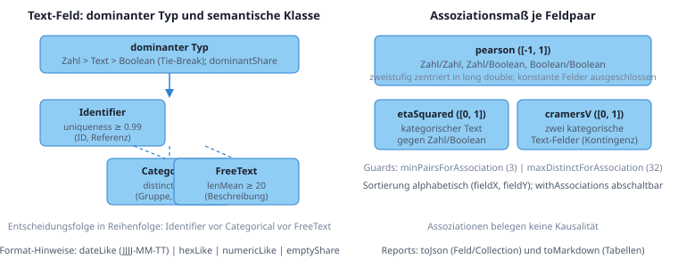

# Gemischte Metadaten-Analyse (FA-33) – API-Referenz

| Feld | Wert |
|---|---|
| Status | umgesetzt – **ohne externe Abhängigkeiten** (nur InMemDB + C++17) |
| Bezug | Anforderungen FA-33 (Kann); Kategorie-2-Pipeline zur Datencharakter-Kategorisierung (FA-29) |
| Modul | `include/memdb/mixed_analysis.hpp` + `src/mixed_analysis.cpp` |

Das Modul interpretiert **gemischte Datenfelder** (Zahlen, Strings, Booleans in einer
Collection) und leitet daraus Metadaten ab, die im Dokument selbst nicht stehen:
dominanter Typ je Feld, Basis-Kennzahlen für Zahlen, semantische Klassen für Texte
(kategorisch, Kennung, Freitext), Format-Hinweise (Datum, Hex, zahlartig),
Boolean-Anteile, Typ-Drift, Missing-Quote und paarweise Assoziationen zwischen
Feldern unterschiedlicher Typen. Es ist die Analyse-Pipeline für Collections der
Kategorie `DataCategory::Mixed` (FA-29).

## Funktionen

```cpp
#include <memdb/memdb.hpp>
#include <memdb/mixed_analysis.hpp>

memdb::MixedAnalysisOptions opts;
//   sampleSize/seed/maxFieldsPerCollection  – Schutz & reproduktives Sampling
//   minValuesPerField (5)      – Felder mit weniger Werten des dominanten Typs werden übersprungen
//   maxCategoryDistinct (12)   – Text gilt als kategorisch, wenn distinct <= X
//   identifierUniqueness (0.99)– Einzigartigkeits-Schwelle für Kennungsfelder
//   freeTextMinLength (20)     – mittlere String-Länge, ab der Freitext vermutet wird
//   discreteMaxRange (100.0)  – diskret, wenn alle Werte ganzzahlig UND Spannweite <= X
//   withAssociations (true)    – paarweise Assoziationen (Pearson/eta²/Cramérs V)
//   minPairsForAssociation (3)– Mindest-Gemeinsamkeit je Feldpaar
//   maxDistinctForAssociation (32) – Kardinalitäts-Guard für eta²/Cramérs V

// Alle Feld-Analysen einer Collection
auto fields = memdb::analyzeMixedFields(coll, opts);

// Komplett: Feld-Analysen + paarweise Assoziationen
memdb::MixedCollectionAnalysis res = memdb::analyzeMixed(coll, opts);
//   res.mixedFieldCount       – analysierter Felder (nach Cap/minValuesPerField)
//   res.associations[i]       – {fieldX, fieldY, measure, value, pairs}
// Mehrere Collections (auch database-übergreifend; __references wird ignoriert)
auto all = memdb::analyzeMixed(db, opts);

// Reports
std::string j  = memdb::toJson(fields[0]); // eine Feld-Analyse
std::string j2 = memdb::toJson(res);      // ganze Collection
std::string md = memdb::toMarkdown(res);   // Tabellen inkl. Assoziationen
```

## Was wird pro Feld analysiert (`MixedFieldAnalysis`)?

| Merkmal | Bedeutung |
|---|---|
| `kind` | dominanter Typ (`MixedKind::Number/Text/Boolean`); Tie-Break bei gleicher Häufigkeit: Zahl > Text > Boolean. `dominantShare` = Anteil des dominanten Typs an den analysierbaren Werten |
| `count`, `distinct`, `missing`, `missingRatio` | Basis-Kennzahlen; `missing` zählt Dokumente mit abwesendem, null-Wertigem oder abweichend typisiertem Feld |
| `min`, `max`, `mean`, `stddev`, `median` | Zahlenteil (Populations-Stdabw., Median per linearer Interpolation; Momente in `long double` mit Finite-Checks) |
| `integralRatio`, `discrete` | Anteil ganzzahliger Werte; diskret, wenn alle ganzzahlig und Spannweite <= `discreteMaxRange` |
| `lenMin`, `lenMax`, `lenMean`, `uniqueness`, `emptyShare` | Textteil: Längen-Statistik, distinct/count, Anteil leerer Strings |
| `textClass` | semantische Klasse: `Identifier` bei `uniqueness >= 0.99`, sonst `Categorical` bei `distinct <= maxCategoryDistinct`, sonst `FreeText` ab `lenMean >= freeTextMinLength` |
| `dateLike`, `hexLike`, `numericLike` | Format-Hinweise: alle Werte ISO-Datum-artig (JJJJ-MM-TT), Hex-Strings oder Zahl-Strings (optionales Vorzeichen, Ziffern, höchstens ein Punkt) |
| `trueShare` | Boolean-Teil: Anteil `true` |
| `note` | Interpretations-Hinweise auf Deutsch (z. B. "kategorisch (3 Werte, 25 % …); datumartig") |



Zwei zentrale Elemente im Bild: links die Analyse eines Text-Feldes entlang der
Entscheidungsfolge vom dominanten Typ zur semantischen Klasse (kategorisch,
Kennung, Freitext) mit Format-Hinweisen, rechts die Maßnahmenauswahl pro
Feldpaar: Pearson für Zahl/Zahl (auch Zahl/Boolean und Boolean/Boolean),
eta² für kategorischen Text gegen Zahl/Boolean und Cramérs V für zwei
kategorische Texte.

## Details

- Read-only; ein Scan pro Collection. `__references` wird ignoriert; die Analyse
  betrachtet jede Collection isoliert.
- Felder mit weniger als `minValuesPerField` Werten des dominanten Typs werden
  übersprungen; nach `maxFieldsPerCollection` Feldern greift der Cap (Kappung
  alphabetisch wie im Discovery-Modul, da die Feld-Reihenfolge der Erstsicht
  der sortierten Dokument-Map folgt).
- Assoziationen benötigen mindestens `minPairsForAssociation` gemeinsame
  Dokumente; konstante Felder (Varianz 0) und Felder über
  `maxDistinctForAssociation` distincten Kategorien werden ausgeschlossen.
- Pearson wird zweistufig mittelwertzentriert in `long double` berechnet und auf
  [-1, 1] begrenzt; eta² und Cramérs V werden auf [0, 1] begrenzt. Assoziationen
  belegen keine Kausalität.
- Sampling (`sampleSize > 0`) ist reproduktiv (fester `seed`); `missingRatio`
  bezieht sich stets auf die gesampelte Dokumentmenge.
- Tests: `tests/test_mixed_analysis.cpp` (129 Checks).

Siehe auch: [character.md](character.md) für die Vorab-Kategorisierung,
[numeric-analysis.md](numeric-analysis.md) für die Kategorie-1-Pipeline und
[influence.md](influence.md) für die Einfluss-Analyse.
