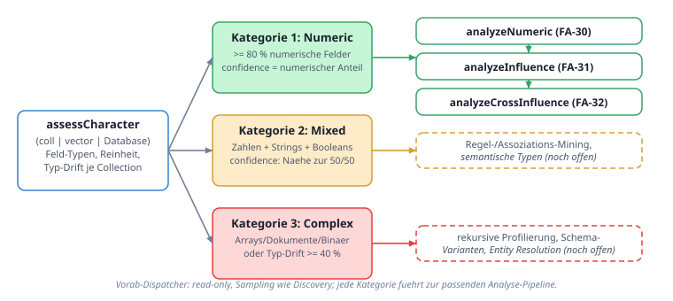

# Data Character Categorization (FA-29) – API Reference

| Field | Value |
|---|---|
| Status | implemented – **no external dependencies** (only InMemDB + C++17) |
| Reference | Requirements FA-29 (optional); builds on Discovery v0.27+ (`DiscoveryOptions`, sampling) |
| Module | `include/memdb/character.hpp` + `src/character.cpp` |

The module answers the preliminary question of any deeper data analysis: **what kind
of data is this, roughly?** Each collection is classified into one of three
categories based on its fields:

| Category | Meaning | Typical analysis pipeline |
|---|---|---|
| `DataCategory::Numeric` | Category 1: almost exclusively numeric fields (>= 80 %) | numeric metadata analysis (`numeric_analysis.hpp`, FA-30) |
| `DataCategory::Mixed` | Category 2: mixture of numbers, strings, booleans | mixed metadata analysis (`mixed_analysis.hpp`, FA-33) |
| `DataCategory::Complex` | Category 3: complex mixed forms (arrays, nested documents, binary, type drift >= 40 %) | recursive profiling, schema variants, entity resolution |



The following graphic summarizes the dispatcher: `assessCharacter` classifies each
collection read-only and routes it to the matching analysis pipeline – category 1
directly into the FA-30/31/32 chain and category 2 into the mixed metadata
analysis FA-33; category 3 remains reserved for future modules.

## Functions

```cpp
#include <memdb/memdb.hpp>
#include <memdb/character.hpp>

memdb::DiscoveryOptions opts; // sampling as in the discovery module (sampleSize, seed)

// Character of one collection: category + statistics + rationale
memdb::CollectionCharacter cc = memdb::assessCharacter(coll, opts);
//   cc.category        -> DataCategory::Numeric / Mixed / Complex
//   cc.confidence      -> 0..1 (share of fields supporting the verdict)
//   cc.rationale       -> plain-text rationale (German, e.g. "3/3 Felder numerisch")
//   cc.numericFields, stringFields, boolFields, complexFields, mixedFields
//   cc.numericFieldRatio, complexFieldRatio, driftFieldRatio
//   cc.fields[i]      -> FieldCharacter per field (dominant type, purity, drift)

// Several collections (cross-database; __references is skipped)
auto ccs = memdb::assessCharacter({db1.collection("sensors"), db2.collection("orders")}, opts);
// Whole database
auto all = memdb::assessCharacter(db, opts);

// Category names ("numeric"/"mixed"/"complex")
std::string name = memdb::toString(cc.category);

// Reports
std::string j  = memdb::toJson(cc);    // single collection (JSON object)
std::string j2 = memdb::toJson(ccs);   // several (JSON array)
std::string md = memdb::toMarkdown(ccs); // overview table
```

## Decision rules

1. Per field the **dominant type** is determined over the non-null values
   (`FieldCharacter::dominantType`, `typePurity`): `numeric` (int/double), `string`,
   `boolean`, `complex` (document/array/binary), `mixed` (several types, purity
   < 0.6), `empty` (only null values).
2. The collection category follows from the shares of **effective** fields
   (at least one non-null value):
   - `Complex` if (complex + mixed) >= 25 % or fields with type drift >= 40 %
   - `Numeric` if numeric >= 80 %
   - otherwise `Mixed`
3. `confidence` measures how clear the verdict is (`Numeric`: numeric share,
   `Complex`: maximum of the triggering shares, `Mixed`: closeness to a 50/50
   split, bounded by the smaller side).

## Details

- Read-only; does not modify data. One scan per collection (sampling as in discovery).
- `maxFieldsPerCollection` (default 64) guards against very wide collections;
  truncation is alphabetical as in the discovery module.
- Empty collections (no fields with values) are classified as `Mixed` with
  `confidence == 0`.
- Tests: `tests/test_character.cpp` (62 checks).

See also: [mixed-analysis.md](mixed-analysis.md) for the category-2 pipeline,
[numeric-analysis.md](numeric-analysis.md) for the category-1 pipeline
and [discovery.md](discovery.md) for the underlying data profiles.
