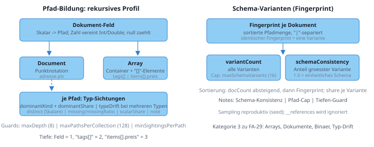

# Complex Metadata Analysis (FA-34) – API Reference

| Field | Value |
|---|---|
| Status | implemented – **no external dependencies** (InMemDB + C++17 only) |
| Reference | Requirements FA-34 (optional); category-3 pipeline for the data character categorization (FA-29) |
| Module | `include/memdb/complex_analysis.hpp` + `src/complex_analysis.cpp` |

The module analyzes **complex data structures** – nested documents, arrays
(including arrays of documents), binary values, and type drift – and derives
metadata that is not stored in the document itself: a recursive path profile in
dot notation (`"address.zip"`, `"tags[]"`, `"items[].price"`), the value types
sighted per path with dominant type and type drift, scalar distinct counts and
missing ratios, plus schema variants (fingerprint groups) with schema
consistency. It is the analysis pipeline for collections of category
`DataCategory::Complex` (FA-29).

## Functions

```cpp
#include <memdb/memdb.hpp>
#include <memdb/complex_analysis.hpp>

memdb::ComplexAnalysisOptions opts;
//   sampleSize/seed          – reproducible sampling (0 = all documents)
//   maxPathsPerCollection (128) – cap: new paths beyond the cap are ignored
//   maxDepth (8)             – nesting guard for the path recursion
//   maxSchemaVariants (16)   – reported variants; further ones are only counted
//   maxDistinctPerPath (4096) – memory guard for distinct values per path
//   minSightingsPerPath (1)  – paths with fewer sightings are skipped

// Path analyses of a collection only
auto paths = memdb::analyzeComplexFields(coll, opts);

// Complete: path profile + schema variants
memdb::ComplexCollectionAnalysis res = memdb::analyzeComplex(coll, opts);
//   res.paths[i]              – {path, depth, kinds, dominantKind, distinct, ...}
//   res.variants[i]           – {fingerprint, fields, docCount, share}
//   res.schemaConsistency     – share of the largest variant
//   res.notes                 – findings (e.g. type drift, caps)
// Several collections (also across databases; __references is ignored)
auto all = memdb::analyzeComplex(db, opts);

// Reports
std::string j  = memdb::toJson(paths[0]); // one path analysis
std::string j2 = memdb::toJson(res);     // whole collection
std::string md = memdb::toMarkdown(res); // tables incl. schema variants
```

## What is analyzed per path (`ComplexPathAnalysis`)?

| Feature | Meaning |
|---|---|
| `path`, `depth`, `isElementPath` | path in dot notation; `depth` 1 = top-level field, `"tags[]"` has depth 2, `"items[].price"` depth 3; `isElementPath` marks `"[]"` element paths |
| `kinds` | sightings per value type (`null`, `boolean`, `number`, `text`, `binary`, `document`, `array`), sorted by type |
| `dominantKind`, `dominantShare` | most frequent type; share of sightings (tie-break: lowest type) |
| `count`, `distinct`, `missing`, `missingRatio` | total sightings; distinct scalar values (capped by `maxDistinctPerPath`); examined documents without this path |
| `scalarShare` | share of scalar sightings (null/boolean/number/text/binary) |
| `typeDrift` | `true` if more than one type was sighted at the path |
| `note` | interpretation hints in German (e.g. `"Typ-Drift: number (60 %), boolean (20 %), text (20 %)"`, `"Array aus Dokumenten (3 Elemente)"`, `"Binärdaten (2 Werte)"`) |

## Schema variants (`ComplexSchemaVariant`)

Every examined document gets a fingerprint from the sorted set of its paths
(`"|"`-separated); documents with an identical fingerprint form one variant.
`schemaConsistency` is the share of the largest variant among the examined
documents (1.0 = uniform schema). Variants are reported by descending document
count and capped via `maxSchemaVariants`; `variantCount` counts all of them.



Two central elements in the picture: on the left the recursive path formation –
scalar values at the field path, arrays produce the container path plus the
`"[]"` element path, documents are resolved via dot notation, each path subject
to the depth and path caps; on the right the schema variants – fingerprint from
sorted paths, grouping, consistency share, and cap.

## Details

- Read-only; one scan per collection. `__references` is ignored; the analysis
  looks at every collection in isolation.
- Numbers unify Int and Double into `number`; `null` at a path counts as a
  sighting (the field exists); absent fields count toward `missing`.
- Guards: after `maxPathsPerCollection` paths, new paths are ignored (note
  `"Pfad-Cap erreicht"`); the recursion stops at `maxDepth` (note
  `"Tiefen-Guard aktiv"`); `distinct` is capped per path at
  `maxDistinctPerPath`; paths below `minSightingsPerPath` sightings are skipped.
- Sampling (`sampleSize > 0`) is reproducible (fixed `seed`); `missingRatio`,
  `share`, and `schemaConsistency` always refer to the sampled document set.
- Reports contain only counters and quotients – no `inf`/`nan` in the JSON by
  construction.
- Tests: `tests/test_complex_analysis.cpp` (175 checks): nested documents,
  arrays and arrays of documents, type drift, schema variants, binary and
  null, sampling, all guards, reports, and empty collections.

See also: [character.md](character.md) for the upfront categorization,
[numeric-analysis.md](numeric-analysis.md) for the category-1 pipeline, and
[mixed-analysis.md](mixed-analysis.md) for the category-2 pipeline.
