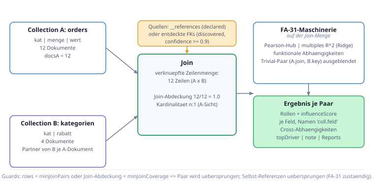

# Cross-Collection Influence Analysis (FA-32) – API Reference

| Field | Value |
|---|---|
| Status | implemented – **without external dependencies** (InMemDB + C++17 only) |
| Reference | Requirements FA-32 (optional); continuation of the influence analysis (FA-31) |
| Module | `include/memdb/cross_influence.hpp` + `src/cross_influence.cpp` |

The module answers the question: **How can dependencies be computed across two
collections?** It joins collection pairs and applies the FA-31 machinery
(Pearson hub, multiple R², functional dependencies, roles, influence score) to
the joined row set. Read-only; result field names are collection-qualified
(`collection.field`).

## Join Sources (both combinable)

1. **Declared references** (`origin: "declared"`): document edges from
   `__references` (FA-18) carrying both endpoints as field values. Edges are
   grouped per (fromCollection, toCollection) and relation, deduplicated into
   (aId, bId) pairs, and joined. Self-references are skipped (that is FA-31
   territory).
2. **Discovered foreign keys** (`origin: "discovered"`):
   `discoverForeignKeys` (FA-27) over all collections; only foreign-key
   relations with confidence >= `minFkConfidence` (default 0.9) and distinct
   collections. The join uses a hash map on the B-side target field.

## Per-Pair Pipeline

- **Join**: A × B via the edges; `rows` is the number of joined rows
  (inflated for 1:n), `matchedA` the number of A documents with at least one
  partner, `joinCoverage = matchedA / docsA`.
- **Cardinality** from A's perspective: `n:1` (default) or `1:n` as soon as
  one A document has multiple B partners.
- **Guards**: `rows < minJoinPairs` (default 10) or
  `joinCoverage < minJoinCoverage` (default 0, off) – the pair is skipped and
  named in `note`.
- **Analysis** on the joined set: Pearson pairs, functional dependencies
  (both directions, direction tie-break via distinct source values) and
  multiple R² with a ridge term, as in FA-31.
- **Trivial join dependency**: the pair (A.joinField, B.keyField) is
  (almost) functional and correlated by construction. With
  `suppressTrivialJoinDependency` (default on) it is removed from Pearson, FD
  and R² predictors.
- `dependencies` lists only dependencies with source and target in different
  collections; roles count all dependencies of the joined set.



The flow as a graphic: both join sources (declared `__references` or discovered
foreign keys) feed the join, guards filter pairs that are too small or too
weakly linked, and the FA-31 machinery analyzes the joined set – the trivial
join dependency stays suppressed by default.

## Options (CrossInfluenceOptions)

| Option | Default | Meaning |
|---|---|---|
| `influence` | `{}` | FA-31 thresholds + numeric base scan (`influence.numeric`) |
| `includeDeclared` | `true` | declared `__references` edges as join source |
| `includeDiscovered` | `true` | discovered foreign keys as join source |
| `minFkConfidence` | `0.9` | minimum confidence of discovered FKs |
| `minJoinPairs` | `10` | minimum rows per pair analysis |
| `minJoinCoverage` | `0.0` | minimum share of matched A documents |
| `suppressTrivialJoinDependency` | `true` | remove the join field pair from evidence |

## Functions

```cpp
#include <memdb/memdb.hpp>
#include <memdb/cross_influence.hpp>

memdb::CrossInfluenceOptions opts;
//   opts.influence            – InfluenceOptions (FA-31): thresholds,
//                                field capping via influence.numeric.maxFieldsPerCollection
//   opts.minJoinPairs (10)    – fewer rows => pair is skipped
//   opts.minFkConfidence (0.9)– minimum confidence of discovered foreign keys

memdb::CrossInfluenceResult res = memdb::analyzeCrossInfluence(db, opts);
//   res.pairs[i].origin       – "declared" | "discovered"
//   res.pairs[i].relation     – relation name or join description
//   res.pairs[i].collectionA / collectionB – the pair (A's perspective)
//   res.pairs[i].docsA / matchedA / rows    – join statistics
//   res.pairs[i].joinCoverage – matchedA / docsA
//   res.pairs[i].cardinality  – "n:1" | "1:n" (from A's perspective)
//   res.pairs[i].fields[j]    – FieldInfluence (FA-31) on the joined set,
//                                field names "collection.field", sorted by score
//   res.pairs[i].dependencies – CrossDependency { source, target, coverage, ... }
//   res.pairs[i].topDriver    – "collection.field" with the highest influence score
//   res.pairs[i].note         – short summary (German)
//   res.note                  – overall summary: pairs, sources, skips

// Reports
std::string json = memdb::toJson(res);      // machine-readable / LLM-friendly
std::string md   = memdb::toMarkdown(res);  // tables per collection pair
```

## Limitations

Correlation still does not prove causation; results are reasoned rankings
from statistical dominance and structural derivation on the joined set.
Discovered joins depend on FK discovery quality (value overlap); with low
join coverage the result describes only the linked portion of the data. No
sampling: the row count is bounded via `minJoinPairs` and field capping.

## Tests

`tests/test_cross_influence.cpp` (180 checks): declared and discovered joins,
roles/top driver on the joined set, trivial suppression, 1:n cardinality,
guards (`minJoinPairs`, `minJoinCoverage`), self-reference skip, confidence
threshold, mixed operation of both sources, empty database, and JSON/Markdown
reports.
