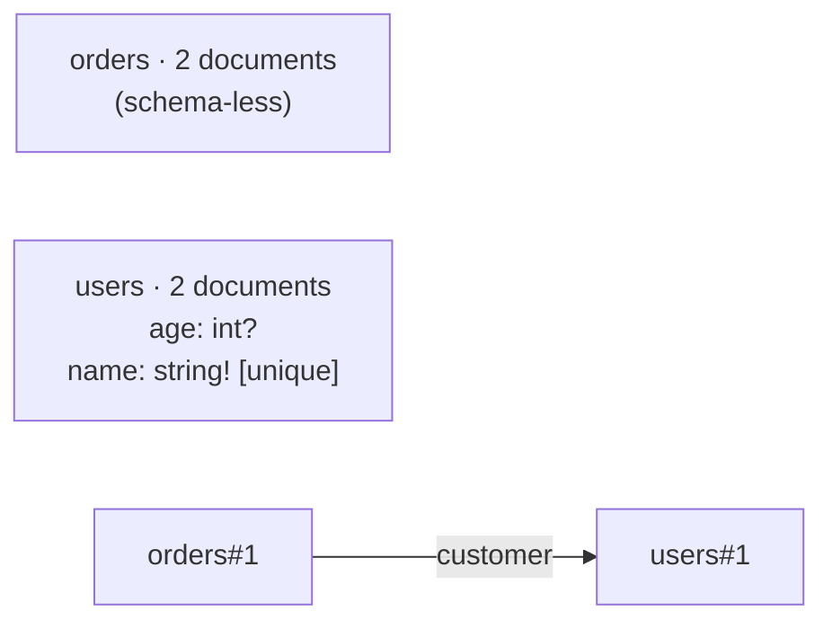

# Visualizing the database graph (FA-22) – v0.15

| Field | Value |
|---|---|
| Status | implemented (v0.15) |
| Reference | requirements FA-22 (optional), FA-14 (snapshot), FA-18 (references), FA-20 (schema), FA-10 (indexes) |
| Dependencies | **none** (only C++17 + own JSON writer/parser) |

Goal: output an existing database – collections incl. optional schema/indexes and their
FA-18 references – as a **text-based graph** that an LLM easily understands and that can be
rendered directly.

## API

```cpp
#include <memdb/memdb.hpp>

memdb::DbGraph g = memdb::DbGraph::fromDatabase(db);              // running DB
memdb::DbGraph g2 = memdb::DbGraph::fromSnapshotFile("shop.inmemdb.json"); // from FA-14 snapshot

std::string mermaid = g.toMermaid();   // "graph LR ..." – renders directly (GitHub/VS Code/LLM)
std::string json    = g.toJson();      // structured for LLM/tooling
std::string md      = g.toMarkdown();  // doc tables
std::string sum     = g.summary();     // "2 collections, 4 documents, 1 references"
```

- `GraphNode`: collection name, document count, `hasSchema`, fields (`GraphField`: name/path,
  type name from `docs/en/guides/type-mapping.md`, `nullable`, index annotation `""`/`"index"`/`"unique"`).
- `GraphEdge`: `from`/`to` as `collection#id` (document) or `collection` (collection level),
  `relation`, `dangling` (target no longer exists).
- The internal storage collection of the references (`__references`) does **not** appear as
  a node, only as edges. With `fromSnapshotFile` document IDs are not in the snapshot –
  `dangling` is then only checked via the target collection.

## Formats

**Mermaid** (default, renders immediately):



Conventions: `?` = nullable, `!` = notNull, `[unique]`/`[index]` = index; edge label =
relation (+ ` (dangling)`); node IDs are sanitized names (`orders#1` → `orders_1`).

**JSON** (machine-readable):

```json
{"collections":[{"name":"users","documents":2,"schema":{"fields":[{"name":"name","type":"string","nullable":false,"index":"unique"}]}},{"name":"orders","documents":2,"schema":null}],"references":[{"from":"orders#1","to":"users#1","relation":"customer","dangling":false}]}
```

**Markdown**: table collections (name, #documents, schema yes/no, fields) + table
references (from, to, relation, dangling).

## CLI

```sh
./build/inmemdb_graph shop.inmemdb.json                 # Mermaid on stdout (+ summary as comment)
./build/inmemdb_graph shop.inmemdb.json --format json
./build/inmemdb_graph shop.inmemdb.json --format all --out graph   # graph.mmd, graph.json, graph.md
```

So an LLM needs **a single snapshot file** as input.

## Implementation

`include/memdb/db_graph.hpp` + `src/db_graph.cpp` (no core changes; reads only the public
API or the snapshot parser `src/json.*`). CLI: `tools/db_graph.cpp` (`inmemdb_graph`).
Example: `examples/15_db_graph.cpp`; tests: `tests/test_db_graph.cpp`.
