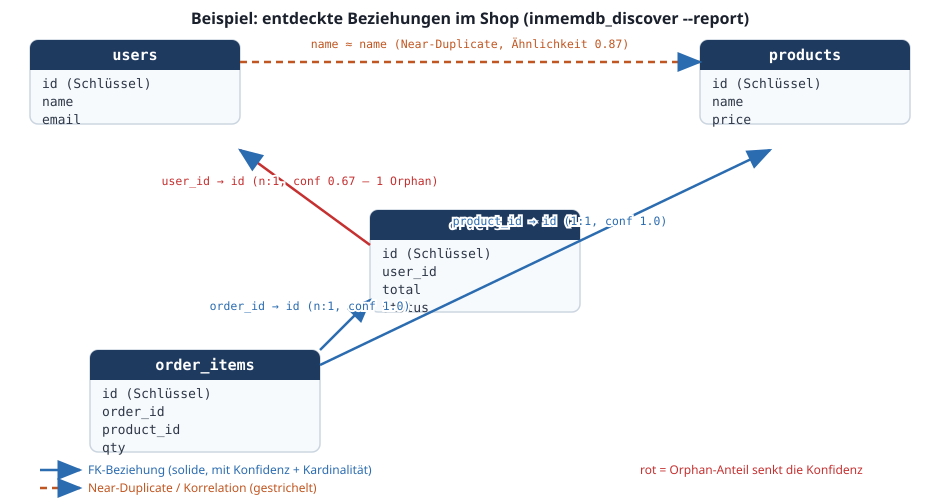
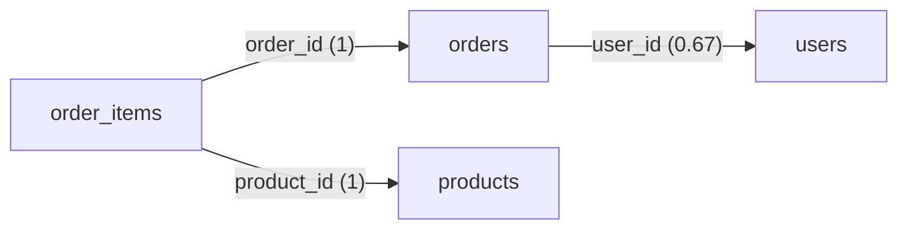
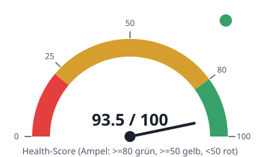

# Discovery guide: automatically find relationships & dependencies (FA-27, v0.29–v0.40)

> 🇩🇪 **Deutsche Version:** [docs/de/guides/discovery-guide.md](../../de/guides/discovery-guide.md)

| Field | Value |
|---|---|
| Module | `include/memdb/discovery.hpp` + `src/discovery.cpp` |
| Dependencies | **none** – only InMemDB itself + C++17 (NFA-06) |
| Effect on data | read-only; changes nothing (except `applyDiscovered`, which deliberately creates references) |
| Scope | cross-collection **and cross-database** |
| API reference | [docs/en/guides/discovery.md](discovery.md) · tests: `tests/test_discovery*.cpp` (124 checks) |

This guide explains **every method of the discovery module in an understandable way with examples**.
The API reference with all signatures is in [docs/en/guides/discovery.md](discovery.md).

---

## 1. What does the discovery module do?

InMemDB is schema-less: relationships between collections do not exist automatically,
they must first be **discovered**. The discovery module examines the existing
**values** and finds out:

- **Foreign keys** (which field references which other field?)
- **Functional dependencies** within a collection (which field determines which other?)
- **Correlations** between fields (do two numbers move together? does a status depend on another field?)
- **Near-duplicates** (almost identical texts, e.g. typos – also across collections)
- **Orphans** (references pointing into the void – integrity check)
- **Candidate keys** (which field combination uniquely identifies a document?)
- **Diffs & merge suggestions** (how similar are two collections/databases?)
- **Outliers** in numeric fields (z-score + IQR/Tukey fence, v0.40) – and as a factor in the health score
- and bundles all of this into an **analysis report with a health score** (`analyze()`, v0.33)

Everything works on an internal snapshot ("scan") per collection: field names plus
per field the set of distinct values and the number of documents carrying the field. For
large collections you can sample reproducibly (`DiscoveryOptions::sampleSize` +
`seed`, uses `Collection::sample`, v0.27).

**Important:** discovery works purely on values. It does not "understand" semantics – a
finding with high confidence is a strong indication, not proof. That is why every finding
has `support`, `confidence`, `sampleSize` and `note`.

---

## 2. Quickstart

### In code

```cpp
#include <memdb/memdb.hpp>
#include <memdb/discovery.hpp>

memdb::Database db("shop");
db.loadFromFile("shop.inmemdb.json");

// everything at once: full analysis with health score + report (v0.33)
memdb::AnalysisReport rep = memdb::analyze(db);
memdb::printSummary(rep, std::cout);              // console
std::ofstream("analysis.md")   << memdb::toMarkdown(rep);   // Markdown report
std::ofstream("analysis.json") << memdb::toJson(rep);       // JSON
std::ofstream("graph.mmd")     << memdb::toMermaid(rep);    // Mermaid graph

// or individually, e.g. only foreign keys (also across several databases):
auto rels = memdb::discoverForeignKeys({db.collection("orders"), db.collection("users")});
```

### Via CLI (snapshot files, several = cross-database)

```sh
inmemdb_discover shop.inmemdb.json                          # relations as JSON
inmemdb_discover shop.inmemdb.json --report analysis        # + analysis.report.md / .relations.json / .graph.mmd
inmemdb_discover a.json b.json --min-confidence 0.9         # stricter FK filter
inmemdb_discover shop.enc --password secret --mermaid       # encrypted file
```

---

## 3. The running example

A small shop as snapshot `shop.inmemdb.json` (created e.g. via CSV import or in code):

| Collection | Fields | Content |
|---|---|---|
| `users` | `id`, `name`, `email` | 3 customers (id 1–3) |
| `products` | `id`, `name`, `price` | 3 products (id 100–102, incl. "Ada Lovelace Poster") |
| `orders` | `id`, `user_id`, `total`, `status` | 3 orders – one with `user_id = 999` (**orphan!**) |
| `order_items` | `id`, `order_id`, `product_id`, `qty` | 3 items |



This is what the relationship graph looks like that `inmemdb_discover --report` outputs as
Mermaid (excerpt, real output):



---

## 4. The methods in detail

### 4.1 `discoverForeignKeys(colls, opts)` – foreign keys via value overlap (v0.29)

**What:** compares every field of every collection with every field of every other collection
(also from different `Database` objects) and reports `A.field → B.targetField` when the
values of `A.field` mostly occur in the values of `B.targetField`.

**How:** per field pair the intersection of the distinct values is formed. A finding
needs **at least 2 common values** (a single hit is coincidence).

- `confidence` = share of the values of `A.field` that occur in `B.targetField`
  (1.0 = all; an orphan lowers the confidence, e.g. 2 of 3 → 0.67)
- `support` = share of the documents of `A` that carry the field at all
- `cardinality` (v0.30, from A's perspective): `1:1` / `n:1` / `1:n` / `n:m` – derived from
  the uniqueness of both sides (distinct == number of documents with the field)
- Name heuristic: findings with `*_id`/`*_ref` as source field or `id`/`pk` as target field
  get `note = "name-heuristic"`; on equal confidence in both directions the reverse
  direction is discarded (the `*_id` side wins)

**Example (shop):** `order_items.order_id → orders.id` with conf 1.0, cardinality `n:1`;
`orders.user_id → users.id` with conf 0.67 because of the orphan 999.

**Tip:** with small test data, spurious findings arise easily (e.g.
`products.price → orders.total` because 12.50 occurs in both). Filter them out with
`opts.minConfidence = 0.9` – but beware: an FK *with* an orphan has conf < 1 and is
filtered out too. For the orphan search prefer `--orphans` (see 4.7).

### 4.2 `discoverFunctionalDependencies(coll, opts)` – X determines Y (v0.29)

**What:** functional dependencies *within* a collection: `X → Y` means
"every X value has at most one Y value" (e.g. `zip → city`).

**How:** per field pair `groupBy(X)` + `AggOp::Distinct` on Y (v0.27); `confidence` = share
of the X groups with a unique Y. If X itself is unique (e.g. `id`), every FD
is trivial – then `note` says "trivial (X unique)".

### 4.3 `discoverCorrelations(coll, opts)` – do two fields move together? (v0.29)

**What:** correlations between fields of a collection.

**How:**
- both fields **numeric** → Pearson correlation, reported at `|r| ≥ minCorrelation`
  (default 0.7), `note` contains "pearson r=…" (positive/negative)
- **categorical** (strings) → association via uncertainty-coefficient-like
  `U(Y|X) = 1 − H(Y|X)/H(Y)` in [0,1]

### 4.4 `discoverNearDuplicates(colls, opts)` – almost identical texts (v0.29)

**What:** string values that differ only slightly – also **across collections/databases**
(e.g. "Ada Lovelace" vs. "Ada Lovelace Poster" or typos like "Müller"/"Muler").

**How:** normalized edit distance (Levenshtein) as similarity in [0,1], strings capped at
64 chars; reported from `minSimilarity` (default 0.85). Quadratic protection:
max `maxValuesPerField` values per field (default 2000). The value pair is in `note`.

### 4.5 `discoverRelations(db | colls, opts)` – everything combined (v0.29)

**What:** FK discovery over all given collections **+ FD + correlation + near-duplicates
per collection**. Pass a `std::vector<Collection>` from several `Database` objects and the
analysis runs cross-database. Result sorted by confidence (descending).

### 4.6 `applyDiscovered(db, rels, refs, minConfidence)` – create findings as real references (v0.29)

**What:** makes FK findings with `confidence ≥ minConfidence` (default 0.9) usable as
**FA-18 references**: per source document `ReferenceIndex::link(..., "discovered_<field>")`
is called. Afterwards the relations are **index-accelerated joinable** (`joinIds`/`join`,
`@relation` in the DSL) and snapshot-capable.

**Note:** only works within one database – cross-database findings skip collections missing
in `db`. Returns: number of created references. CLI: `--apply` (writes the snapshot file back).

### 4.7 `findOrphans(...)` / `findOrphansForRelations(colls, rels, opts)` – references into the void (v0.30)

**What:** integrity check – the counterpart to `skippedForeignKeys` on import (v0.28).
An orphan is a source value with **no** counterpart in the target field.

**How:** `findOrphans(source, field, target, targetField)` checks one field pair and returns
`OrphanReport{fromCollection, field, toCollection, toField, scanned, orphans, orphanValues}`
(the orphan values themselves, capped at 100). `findOrphansForRelations` does this for
all FK findings at once.

**Example (shop, real CLI output):**
```json
{"orphans":[{"from":"orders.user_id","to":"users.id","scanned":3,"orphans":1}, ...]}
```
→ the value `999` in `orders.user_id` has no `users.id`. CLI: `--orphans`.

### 4.8 `findPaths(rels, from, to, maxDepth)` – multi-hop paths in the relationship graph (v0.30)

**What:** all FK paths from collection `from` to `to` (depth-first search, `maxDepth` limits,
default 4). Each path is a chain of FK relations – directly usable as a multi-stage join.

**Example:** `findPaths(rels, "order_items", "users")` finds
`order_items.order_id → orders.id` and then `orders.user_id → users.id`.
CLI: `--path order_items users`.

### 4.9 `profileCollection(coll, opts)` – data profile (v0.31)

**What:** statistical overview of a collection: `CollectionProfile{collection,
docCount, sampleSize, fields[]}`. Per field (`FieldProfile`): type distribution
(`typeCounts` as `map<Value::Type, size_t>`), `present` (documents with the field), `nulls`,
`distinct`, ordered `min`/`max` (for numbers/strings) and up to 3 example values.
Report: `toJson(profile)`. Read-only; sampled with `sampleSize`.

### 4.10 `discoverCandidateKeys(coll, opts)` – find unique keys (v0.31)

**What:** minimal field sets that uniquely identify documents (similar to FD
`X → all fields`). Single fields first; pairs only if neither alone is already a key.
Result ascending by size.

**Beware:** in small test data almost every field is "unique" – for meaningful
keys you need enough documents.

### 4.11 `diffCollections(a, b)` / `diffDatabases(dbA, dbB)` – how similar are two data sets? (v0.32)

**What:** `CollectionDiff` compares two collections: fields only in A / only in B /
common, Jaccard similarity of the field names (`fieldSimilarity`), row counts and per
common field the value overlap (`valueOverlap = |A ∩ B| / |A|`). `diffDatabases`
does this pairwise for all same-named collections of two databases
(`DatabaseDiff`, `__references` is ignored). Report: `toJson(diff)`.
CLI: `--diff a.json b.json`.

### 4.12 `suggestMerges(colls, opts)` – merge candidates for FA-24 (v0.32)

**What:** pairwise suggestions which collections could be merged with
`Database::mergeCollections` (v0.24/25): `MergeSuggestion{collectionA, collectionB,
schemaSimilarity (Jaccard of the field names ≥ minSchemaSimilarity, default 0.6),
valueOverlap, commonField, note}`. Also cross-database. Sorted by
schema similarity. CLI: `--suggest-merges`.

### 4.13 `analyze(...)` – the automatic full analysis (v0.33)

**What:** one call that bundles everything: `analyze(Database&)` or cross-database
`analyze(std::vector<Collection>)`. Returns `AnalysisReport`:

| Field | Content |
|---|---|
| `profiles` | `profileCollection` per collection (v0.31) |
| `relations` | all findings via `discoverRelations` (v0.29/30) |
| `orphans` | `findOrphansForRelations` (v0.30) |
| `mergeSuggestions` | `suggestMerges` (v0.32) |
| `paths` | most important multi-hop FK paths (max 20) |
| `outliers` | outliers per numeric field via `discoverOutliers` (v0.40) |
| `confusion` | confusion matrix of the FK findings vs. `__references` (v0.42, only `analyze(Database&)`) |
| `totalCollections`, `totalDocs` | sums |
| `healthScore` | **0–100**, see 4.14 |

### 4.14 The health score (v0.33, weights from v0.40)

`healthScore = 100 · (0.30·integrity + 0.15·redundancy + 0.20·structure + 0.20·typeConsistency + 0.15·outliers)`

(v0.33–v0.39: `100 · (0.35·integrity + 0.20·redundancy + 0.25·structure + 0.20·typeConsistency)` –
v0.40 added the outlier factor and renormalized the weights accordingly.)

| Component | Meaning | Calculation |
|---|---|---|
| Integrity (0.30) | references into the void | `1 − orphan rate` (orphans / checked source values; without orphans = 1.0) |
| Redundancy (0.15) | duplicate records | `1 − near-duplicate rate` (near dupes / documents) |
| Structure (0.20) | linked collections | share of collections in at least one FK relation; **without FKs neutral 1.0** (missing relations are not a defect) |
| Type consistency (0.20) | unclean fields | average share of the dominant type per field (e.g. 90 % int + 10 % string → 0.9) |
| Outliers (0.15) | statistical outliers | `1 − min(1, outlier rate)` over all numeric values (see 4.16); **without numeric values neutral 1.0** |

Traffic light: 🟢 ≥ 80 · 🟡 ≥ 50 · 🔴 < 50.



**Example (shop):** 1 orphan among 3 scanned `user_id` values → integrity 0.667;
no dupes, all 4 collections in FK relations, all fields type-pure, no
outliers → **Health = 100·(0.30·0.667 + 0.15 + 0.20 + 0.20 + 0.15) = 85.0 🟢**.

### 4.15 Presenting the report: `toJson` / `toMarkdown` / `toMermaid` / `printSummary` (v0.33)

| Function | Purpose | Example |
|---|---|---|
| `toJson(report)` | machine-readable / LLM-friendly | `{"healthScore":85, "totalCollections":4, "profiles":[…], "relations":[…], "orphans":[…], "mergeSuggestions":[…], "paths":[…], "outliers":[…]}` |
| `toMarkdown(report)` | human-readable report | `# InMemDB analysis report` with overview table (profiles), "Discovered relations", "Integrity (orphans)", "Merge suggestions", "Outliers", "Recommendations" |
| `toMermaid(report)` | graph (GitHub renders Mermaid) | FKs as solid edges with confidence label, correlations as dashed self-loops |
| `printSummary(report, ostream)` | compact console | `InMemDB analysis: 4 collections, 12 documents, Health 85/100 🟢` + top FKs |

Real console output for the shop:

```
InMemDB analysis: 4 collections, 12 documents, Health 85/100 🟢
  Relations: 37, Orphans: 5, Merge suggestions: 0, Outliers: 0
  FK  order_items.order_id -> orders.id (conf=1, n:1)
  FK  order_items.product_id -> products.id (conf=1, 1:1)
  FK  orders.user_id -> users.id (conf=0.666…, 1:1)
```

CLI writes all three files at once:
`inmemdb_discover shop.inmemdb.json --report analysis` →
`analysis.report.md` + `analysis.relations.json` + `analysis.graph.mmd`.

### 4.16 Outlier detection: `discoverOutliers(coll | colls | db, opts)` (v0.40)

**What:** per numeric field (int/double) statistical outliers are detected –
combined from **z-score** (|z| > `outlierZ`, default 3.0) and **IQR/Tukey fence**
(value outside `[Q1 − k·IQR, Q3 + k·IQR]`, `k = outlierIqrK`, default 1.5).
Quantiles via linear interpolation. A field is only checked if it has at least
`minOutlierSamples` (default 8) numeric values (lower this for small data sets);
sampling via `sampleSize`/`seed` is respected. Read-only, also cross-database.

```cpp
memdb::DiscoveryOptions opts;
opts.minOutlierSamples = 4;                 // small test data
auto outs = memdb::discoverOutliers(db, opts);        // Database& or vector<Collection>
for (const auto& f : outs)                   // f = FieldOutliers
    std::cout << f.collection << "." << f.field << ": " << f.outliers << "/" << f.count
              << " (" << f.method << ")\n";           // method: "z-score" / "IQR" / "z-score+IQR"
```

`FieldOutliers` provides: `count`, `mean`, `stddev`, `q1`, `median`, `q3`, `iqr`,
`outliers` (count), `outlierRate`, `method` and up to 100 example values (`values`).
Only fields **with at least one outlier** appear in the result.

**Integration into `analyze()`:** `AnalysisReport::outliers` contains the findings; they
feed into the health score as the fifth factor (weight 0.15)
(`1 − min(1, outlier rate)` over all numeric values; without numeric values neutral 1.0)
and appear in all four presentations: JSON (`"outliers":[...]`), Markdown
(own "Outliers" section), `printSummary` (`Outliers: N`) and as a recommendation.

**Real console output** (`inmemdb_discover shop.json --outliers`, 9 products,
including `price = 999.0` as a pricing error):

```
{"outliers":[{"from":"products.price","count":9,"outliers":1,"rate":0.111111,"method":"IQR"}]}
```

```
InMemDB analysis: 1 collections, 9 documents, Health 98.33333333333331/100 🟢
  Relations: 6, Orphans: 0, Merge suggestions: 0, Outliers: 1
```

**CLI:** `inmemdb_discover a.json --outliers` prints the outlier report as JSON to
stdout (in addition to the normal relations report); `--report <prefix>`
integrates the outliers into `.report.md` / `.relations.json`.

### 4.17 Confusion matrix: discovered FKs vs. declared references (v0.42)

**What:** `evaluateConfusion(rels, db, opts)` compares the FK findings with the **actually
declared references** in `__references` (e.g. from FK import FA-26 or `applyDiscovered`) –
this is the confusion matrix of FK discovery: TP/FP/FN/TN over all directed collection pairs
(A,B), A ≠ B, plus precision/recall/F1.

- **predicted positive:** pair (A,B) with an FK finding and `confidence >= opts.confusionMinConfidence`
  (default 0.9 – threshold configurable).
- **actual positive:** pair (A,B) with at least one reference in `__references`.
- `analyze(Database&, opts)` fills `AnalysisReport::confusion` (only when `__references` exists);
  the cross-database variant `analyze(vector<Collection>, opts)` omits it.
- All presentations: JSON (`"confusion":{...}`), Markdown ("Confusion-Matrix" section),
  `printSummary` (`Confusion (FK vs. references): TP=… F1=…`).

**Real console output** (`inmemdb_discover shop.inmemdb.json --confusion`, users/orders/logs
with one declared reference orders→users but three discovered FK pairs):

```
{"tp":1,"fp":3,"fn":0,"tn":2,"precision":0.25,"recall":1,"f1":0.4}
```

```cpp
memdb::ConfusionMatrix cm = memdb::evaluateConfusion(rels, db, opts);
// cm.tp/fp/fn/tn, cm.precision, cm.recall, cm.f1
```

**CLI:** `--confusion` (exactly one file with `__references`); `--report <prefix>` includes the
matrix automatically for a single file.

---

## 5. `DiscoveryOptions` – all knobs at a glance

| Option | Default | Meaning |
|---|---|---|
| `minSupport` | 0.8 | minimum share of source documents carrying the field (FK) |
| `minConfidence` | 0.0 | minimum confidence for FK/FD candidates |
| `minCorrelation` | 0.7 | `|r|` or association from which a correlation is reported |
| `minSimilarity` | 0.85 | normalized similarity for near-duplicates |
| `sampleSize` | 0 (= all) | 0 = all documents; otherwise reproducible sample (`sample(seed)`) |
| `seed` | 42 | seed for sampling (reproducible) |
| `maxFieldsPerCollection` | 64 | protection against very wide collections |
| `maxValuesPerField` | 2000 | protection for fuzzy matching (values per field) |
| `minSchemaSimilarity` | 0.6 | minimum Jaccard for merge suggestions (v0.32) |
| `outlierZ` | 3.0 | z-score threshold for outliers (v0.40) |
| `outlierIqrK` | 1.5 | Tukey factor k for the IQR fence (v0.40) |
| `minOutlierSamples` | 8 | minimum number of numeric values per field before checking (v0.40) |
| `confusionMinConfidence` | 0.9 | confusion matrix: FK finding counts as predicted positive from this confidence (v0.42) |

---

## 6. CLI complete: `inmemdb_discover`

```sh
inmemdb_discover <file1> [file2 ...] [options]
```

| Option | Effect |
|---|---|
| `--password <pw>` | read encrypted snapshot file |
| `--min-support X` / `--min-confidence X` / `--min-correlation X` / `--min-similarity X` | thresholds (see DiscoveryOptions) |
| `--sample N` / `--seed N` | reproducible sampling |
| `--mermaid` | Mermaid graph instead of JSON on stdout |
| `--orphans` | additional orphan report (JSON) |
| `--outliers` | additional outlier report (JSON, v0.40) |
| `--confusion` | confusion matrix vs. `__references` (JSON, v0.42; only 1 file with references) |
| `--path A B` | FK paths from collection A to B |
| `--diff` | (with ≥ 2 files) `diffDatabases` as JSON |
| `--suggest-merges` | merge suggestions as JSON |
| `--report <prefix>` | full analysis (v0.33): summary on console + `<prefix>.report.md` / `.relations.json` / `.graph.mmd` |
| `--apply` | create FK findings (conf ≥ `--min-confidence`) as FA-18 references + write files back |
| `--out <file>` | write JSON report to file |

Multiple files = **cross-database** analysis over all collections of all files.
`__references` is never analyzed as a data collection.

---

## 7. Limits & tips

- **Heuristic instead of semantics:** FK detection is based on value overlap + name heuristic
  (`*_id`/`*_ref` → `id`/`pk`). At least 2 common values required. Check confidence!
- **Small data sets** produce many spurious findings (every field is "unique" →
  trivial FDs; coincidental value hits). Filter with `minConfidence`/`minSupport` and
  read `note` ("trivial", "name-heuristic").
- **FK with orphan** has conf < 1 → not visible at high `minConfidence`; check orphans
  separately with `findOrphans`/`--orphans`.
- **Performance:** one scan per collection (possibly sampled); FK comparison is
  intersection-based (ValueLess sets), fuzzy matching is capped by `maxValuesPerField`
  and strings capped at 64 chars.
- **`analyze()` is read-only** and usable cross-database – ideal for
  data-quality checks after an import (e.g. SQL/SQLite, see
  [docs/en/guides/import.md](import.md); FKs imported there land as references, missing
  relations are found here).
- **`applyDiscovered` only within one database** – cross-database findings are skipped.

---

## 8. Further reading

- API reference with all signatures: [docs/en/guides/discovery.md](discovery.md)
- Import incl. FK import (FA-26): [docs/en/guides/import.md](import.md)
- References & joins (FA-18): [docs/en/guides/references.md](references.md)
- Merging collections (FA-24): [docs/en/guides/merge-collections.md](merge-collections.md)
- Cross-collection influence analysis (FA-32): discovered foreign keys as a join source for dependencies across collection boundaries – [docs/en/guides/cross-influence.md](cross-influence.md)
- Tests: `tests/test_discovery.cpp` (21), `test_discovery2.cpp` (17), `test_discovery3.cpp`
  (18), `test_discovery4.cpp` (19), `test_discovery5.cpp` (23), `test_discovery6.cpp` (26, v0.40), `test_discovery7.cpp` (29, v0.42) – 153 checks in total
