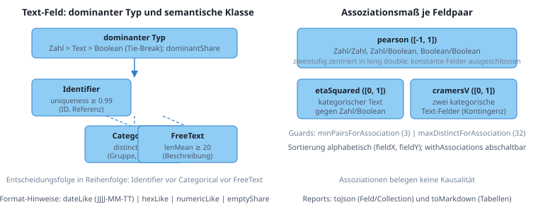

# Mixed Metadata Analysis (FA-33) – API Reference

| Field | Value |
|---|---|
| Status | implemented – **no external dependencies** (InMemDB + C++17 only) |
| Reference | Requirements FA-33 (optional); category-2 pipeline for the data character categorization (FA-29) |
| Module | `include/memdb/mixed_analysis.hpp` + `src/mixed_analysis.cpp` |

The module interprets **mixed data fields** (numbers, strings, booleans within one
collection) and derives metadata that is not stored in the document itself:
dominant type per field, basic statistics for numbers, semantic classes for texts
(categorical, identifier, free text), format hints (date, hex, numeric-like),
boolean shares, type drift, missing ratio and pairwise associations between
fields of different types. It is the analysis pipeline for collections of
category `DataCategory::Mixed` (FA-29).

## Functions

```cpp
#include <memdb/memdb.hpp>
#include <memdb/mixed_analysis.hpp>

memdb::MixedAnalysisOptions opts;
//   sampleSize/seed/maxFieldsPerCollection  – protection & reproducible sampling
//   minValuesPerField (5)      – fields with fewer values of the dominant type are skipped
//   maxCategoryDistinct (12)   – text is categorical if distinct <= X
//   identifierUniqueness (0.99)– uniqueness threshold for identifier fields
//   freeTextMinLength (20)     – mean string length from which free text is assumed
//   discreteMaxRange (100.0)  – discrete if all values integral AND range <= X
//   withAssociations (true)    – pairwise associations (Pearson/eta²/Cramér's V)
//   minPairsForAssociation (3)– minimum co-occurrence per field pair
//   maxDistinctForAssociation (32) – cardinality guard for eta²/Cramér's V

// All field analyses of one collection
auto fields = memdb::analyzeMixedFields(coll, opts);

// Complete: field analyses + pairwise associations
memdb::MixedCollectionAnalysis res = memdb::analyzeMixed(coll, opts);
//   res.mixedFieldCount       – analyzed fields (after cap/minValuesPerField)
//   res.associations[i]       – {fieldX, fieldY, measure, value, pairs}
// Several collections (also across databases; __references is ignored)
auto all = memdb::analyzeMixed(db, opts);

// Reports
std::string j  = memdb::toJson(fields[0]); // a single field analysis
std::string j2 = memdb::toJson(res);      // whole collection
std::string md = memdb::toMarkdown(res);   // tables including associations
```

## What is analyzed per field (`MixedFieldAnalysis`)?

| Feature | Meaning |
|---|---|
| `kind` | dominant type (`MixedKind::Number/Text/Boolean`); tie-break at equal frequency: number > text > boolean. `dominantShare` = share of the dominant type among the analyzable values |
| `count`, `distinct`, `missing`, `missingRatio` | basic statistics; `missing` counts documents with an absent, null-typed or differently typed field |
| `min`, `max`, `mean`, `stddev`, `median` | number part (population std deviation, median via linear interpolation; moments in `long double` with finite checks) |
| `integralRatio`, `discrete` | share of integral values; discrete if all integral and range <= `discreteMaxRange` |
| `lenMin`, `lenMax`, `lenMean`, `uniqueness`, `emptyShare` | text part: length statistics, distinct/count, share of empty strings |
| `textClass` | semantic class: `Identifier` if `uniqueness >= 0.99`, else `Categorical` if `distinct <= maxCategoryDistinct`, else `FreeText` from `lenMean >= freeTextMinLength` |
| `dateLike`, `hexLike`, `numericLike` | format hints: all values ISO-date-like (YYYY-MM-DD), hex strings or numeric strings (optional sign, digits, at most one dot) |
| `trueShare` | boolean part: share of `true` |
| `note` | interpretation hints in German (e.g. "kategorisch (3 Werte, 25 % …); datumartig") |



Two central elements in the image: on the left the analysis of a text field along
the decision sequence from the dominant type to the semantic class (categorical,
identifier, free text) with format hints, on the right the measure selection per
field pair: Pearson for number/number (also number/boolean and boolean/boolean),
eta² for a categorical text against number/boolean and Cramér's V for two
categorical texts.

## Details

- Read-only; one scan per collection. `__references` is ignored; the analysis
  considers each collection in isolation.
- Fields with fewer than `minValuesPerField` values of the dominant type are
  skipped; the cap applies after `maxFieldsPerCollection` fields (truncation is
  alphabetical as in the discovery module, since the field order of first sight
  follows the sorted document map).
- Associations require at least `minPairsForAssociation` common documents;
  constant fields (variance 0) and fields above `maxDistinctForAssociation`
  distinct categories are excluded.
- Pearson is computed two-pass mean-centered in `long double` and clamped to
  [-1, 1]; eta² and Cramér's V are clamped to [0, 1]. Associations do not
  establish causation.
- Sampling (`sampleSize > 0`) is reproducible (fixed `seed`); `missingRatio`
  always refers to the sampled document set.
- Tests: `tests/test_mixed_analysis.cpp` (129 checks).

See also: [character.md](character.md) for the up-front categorization,
[numeric-analysis.md](numeric-analysis.md) for the category-1 pipeline and
[influence.md](influence.md) for the influence analysis.
