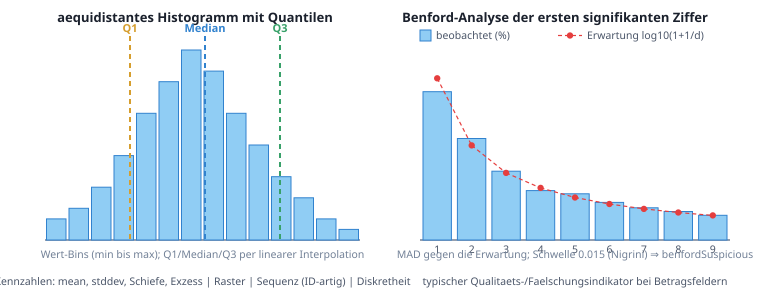

# Numeric Metadata Analysis (FA-30) – API Reference

| Field | Value |
|---|---|
| Status | implemented – **no external dependencies** (only InMemDB + C++17) |
| Reference | Requirements FA-30 (optional); category-1 pipeline for data character categorization (FA-29) |
| Module | `include/memdb/numeric_analysis.hpp` + `src/numeric_analysis.cpp` |

The module interprets **purely numeric data fields** statistically and derives
metadata that is not stored in the documents themselves: scale type, rounding grid,
sequence character (ID-like?), Benford conformity, distribution shape and linear
relationships between fields. It is the analysis pipeline for collections of
category `DataCategory::Numeric` (FA-29).

## Functions

```cpp
#include <memdb/memdb.hpp>
#include <memdb/numeric_analysis.hpp>

memdb::NumericAnalysisOptions opts;
//   sampleSize/seed/maxFieldsPerCollection  – guards & reproducible sampling
//   minValuesPerField (5)      – fields with fewer numeric values are skipped
//   histogramBins (10)         – 0 = no histogram
//   discreteMaxRange (100.0)  – discrete if all values integral AND range <= X
//   gridMinRatio (0.95)        – share of values exactly on the rounding grid
//   benfordMinSamples (30)    – minimum values for Benford analysis
//   benfordMadCritical (0.015)– first-digit MAD threshold (Nigrini)
//   withCorrelations (true)    – Pearson per numeric field pair

// All field analyses of one collection
auto fields = memdb::analyzeNumericFields(coll, opts);

// Complete: field analyses + pairwise Pearson correlations
memdb::NumericCollectionAnalysis res = memdb::analyzeNumeric(coll, opts);
//   res.numericFieldRatio     – share of numeric fields
//   res.correlations[i]       – {fieldX, fieldY, pearson, pairs}
// Several collections (cross-database; __references is skipped)
auto all = memdb::analyzeNumeric(db, opts);

// Reports
std::string j  = memdb::toJson(fields[0]); // one field analysis
std::string j2 = memdb::toJson(res);      // whole collection
std::string md = memdb::toMarkdown(res);   // tables incl. correlations
```

## What is analyzed per field (`NumericFieldAnalysis`)?

| Feature | Meaning |
|---|---|
| `count`, `distinct`, `min`, `max`, `mean`, `stddev` | basic statistics (population stddev) |
| `q1`, `median`, `q3`, `iqr` | quantiles via linear interpolation |
| `skewness`, `kurtosis` | moment estimators; kurtosis as **excess** (normal distribution = 0) |
| `integralRatio`, `discrete` | share of integral values; discrete/ordinal if all integral and range <= `discreteMaxRange` |
| `hasGrid`, `grid`, `gridRatio` | largest rounding grid (candidates 100000 … 0.0001) on which >= `gridMinRatio` of the values lie; price/cent grids. Purely integral fields do not report a grid <= 1 |
| `sequenceAnalyzed`, `monotonic`, `consecutive`, `stepMedian`, `gaps` | sequence character in **insertion order** (via DocumentId): surrogate-ID-like (step 1, gapless), monotonic with median step width and gap count. Full scan only (sampling destroys the order) |
| `benfordApplicable`, `benfordSuspicious`, `benfordMad`, `firstDigitFreq` | Benford analysis of the first significant digit (MAD against the Benford distribution, threshold 0.015 per Nigrini); common fraud/quality indicator for amounts |
| `histogram`, `binMin`, `binWidth` | equidistant histogram over min..max |
| `note` | interpretation hints in German (e.g. "diskret …; sequenzielle ID (Schritt 1, keine Lücken); Raster 100 …") |



Two core features at a glance: on the left an equidistant histogram with the
quantiles obtained via linear interpolation, on the right the Benford analysis of
the first significant digit against the expected distribution `log10(1+1/d)` – a
MAD >= 0.015 against the expectation flags the field as `benfordSuspicious`.

## Details

- Read-only; one scan per collection. Sequence analyses reconstruct the insertion
  order via the DocumentId (IDs are assigned sequentially) because the document
  map iterates unordered.
- Correlations need at least 3 documents with both fields; constant fields
  (variance 0) are omitted.
- Findings are hints, not proof – Benford and grids react sensitively to small
  value sets.
- Hardening: quantiles are interpolated in `long double` (opposing extreme
  values ±1e308 previously turned Q1/median/Q3 into `inf`), the IQR gets a
  finiteness fallback, and non-representable sequence jumps (> DBL_MAX) are
  skipped; reports stay valid JSON.
- Tests: `tests/test_numeric_analysis.cpp` (136 checks).

See also: [character.md](character.md) for the upfront categorization and
[discovery.md](discovery.md) for outlier detection (z-score/IQR) and data profiles.
